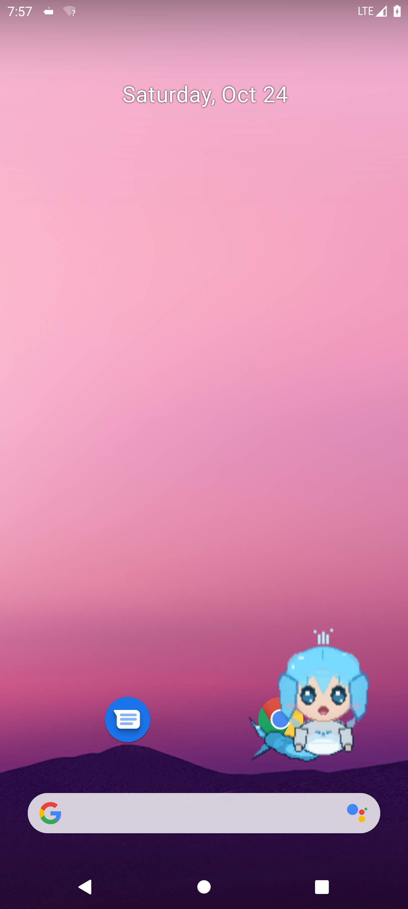
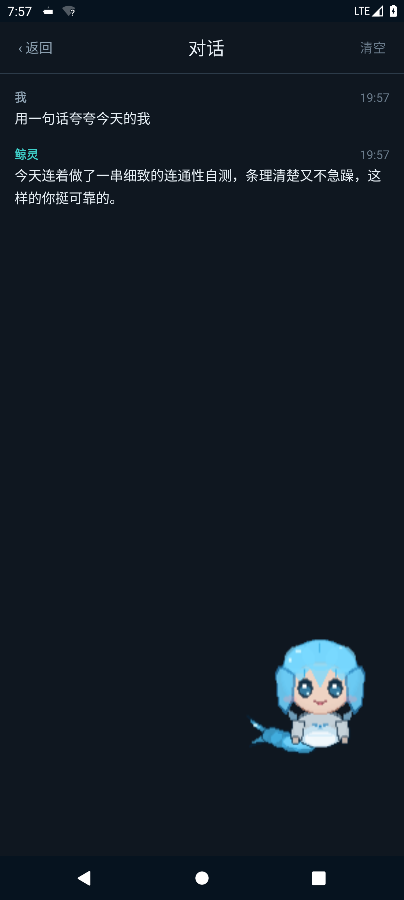

# 鲸灵 · 随身宠物

一只住在你电脑里的像素鲸鱼娘。**屏幕和麦克风在你手上，大脑跑在你自己电脑上的 [DeepSeek Harness](https://github.com/deepseek-ai) 会话里。**



手机端是一个 30 MB 的 Android App：桌面悬浮着会呼吸、会说话的小鲸鱼，点一下就能说话，
它把你这句话派给电脑上的专属会话，边生成边把回复念出来、把动作放出来。电脑关机，它就不在——
**没有云、没有账号、不经过任何第三方服务器。**

## 现在能用吗

| 项 | 状态 |
| --- | --- |
| APK | `0.9.6`（versionCode 76），Android 8.0+（API 26），targetSdk 35 |
| 验证环境 | Android 11 模拟器（1080×2340）跑通全链路：配对、语音、回复、动作、历史、检查更新 |
| 真机 | 厂商权限跳转与硬件麦克风只在 AOSP 页面验证过，各家 ROM 仍可能不同，欢迎回报 |
| iOS | 不支持（悬浮窗与常听麦克风是 Android 特性） |

安装包在 [Releases](../../releases/latest)。这是维护者自签名的构建，签名指纹写在
[docs/android-app.md](docs/android-app.md)；要自己签就照「开发与构建」编译。

## 三步用起来

**1. 电脑上装插件**

```bash
rsync -a --delete plugins/dsh-pet-voice/ ~/.dsh/plugins/dsh-pet-voice/
# 然后重启一次桌面端，让它重读 cordis.patch.yml
```

装好后桌面端侧栏出现「大肥鱼」，点开是它的面板。

**2. 电脑上出配对码**

面板 →「配对」→ 选传输方式 → 得到二维码（或复制链接）。链接长这样：

```
https://<你的地址>/pet-voice/?k=<一次性配对码>
```

**3. 手机上扫码**

装 APK → 首页「扫码绑定」→ 扫上一步的二维码 → 「立即对话」。
悬浮窗出现后，说「大肥鱼」唤醒，或者直接点它说话。

> 手机和电脑必须能互相访问。最省事的是同一个 WiFi（局域网档），在外面用就选内网穿透。
> 三种通路怎么选、怎么配，见 **[docs/self-host.md](docs/self-host.md)** —— 全部是你自己的基础设施，
> 插件不硬编码任何人的服务器。

## 能做到什么

- **说停就停**：尾静音 1 秒判定说完，不是固定 6 秒录音；悬浮窗里可以连续对话。
- **回复一定到**：先试长连接，拿不到立刻转轮询；网络一断自动重连，断网期间的话不会丢。
- **动作有反馈**：听、想、说、待机四种状态各有动作，动作时长按素材本身走，不靠固定计时器。
- **能翻历史**：手机上能看这个会话的完整对话，也能切项目、切人设、开新会话。
- **8 套衣服**：水手裙 / 女仆装 / 鲸鱼卫衣 / 冬日斗篷 / 深海公主 / 深海研究员 / 星潮小魔女 / 泡泡睡衣，设置里直接换。
- **面板可配**：人设、输出长度、气泡开关、唤醒词、传输方式都在插件面板里改，改完手机立刻按新规矩走。
- **检查更新**：App 内直接下载安装，覆盖安装保留配对信息。



## 三种自接入方式

开源版默认**不使用作者的任何基础设施**，代码里没有硬编码的域名或 IP。

| 方案 | 适用 | 需要 | 面板选哪档 |
| --- | --- | --- | --- |
| A 内网穿透 | 在外面也想用，不想碰路由器和证书 | 装 `cloudflared` 或 `ngrok` | 自建域名，填工具给的 https 地址 |
| B 自建域名 + 反代 | 长期用、自己有域名 | 一台能跑 nginx/caddy 的机器 + 证书 | 自建域名，填自己的域名 |
| C 纯局域网 | 手机和电脑同一个 WiFi | 无 | 局域网 |

细节、证书、排错：[docs/self-host.md](docs/self-host.md)。
不想买域名也能 https：[docs/tls-self-signed.md](docs/tls-self-signed.md)。

## 它怎么工作

```
手机（悬浮窗 WebView）                 电脑（DSH 宿主进程）
  说话 ──► /api/asr   ──► 识别文本
         ──► /api/command ──► 切项目 / 派发 / 停
         ──► /api/dispatch ──► 专属会话（带人设）
  听 ◄── SSE 增量 / /api/poll 兜底 ◄── 逐字生成
  念 ◄── /api/tts    ◄── 句子级音频
```

接口一条条写在 [docs/pet-contract.md](docs/pet-contract.md)：端点、鉴权、帧格式、错误码。
手机端实现与限制见 [docs/android-app.md](docs/android-app.md)。

## 开发与构建

```bash
# 自测（离线部分不碰真实配置）
SKIP_LIVE=1 bash scripts/verify.sh

# 编 APK（JDK 17，别用 21+）
export JAVA_HOME=~/jdk17/Contents/Home
./gradlew -p android :app:assembleRelease
```

产物在 `android/app/build/outputs/apk/release/app-release.apk`。
要发布自己的版本，用同一个 keystore 签名才能覆盖安装、保住配对信息，
流程见 [docs/android-app.md](docs/android-app.md) 的发布一节。

参与开发前请读 [CONTRIBUTING.md](CONTRIBUTING.md)；安全问题走 [SECURITY.md](SECURITY.md)。

## 目录

```
plugins/dsh-pet-voice/   DSH 插件：/pet-voice/ 页面、语音闭环、配对、更新通道
  public/                手机页与像素素材（v3 素材 8 套 × 3 动作）
  selftest.mjs           离线自测（模拟 HOME，不碰真实配置）
mcp/pet-bridge/          MCP 服务端：把鲸灵能力暴露给外部助手
android/                 Android 客户端（Kotlin，零 androidx）
docs/                    契约、安装、自接入、真机、架构与早期调研
scripts/                 自测、验收、素材生成、发布
demo/                    早期零依赖原型（可单独跑）
bench/                   时延与编解码的可复现测试
```

早期调研（为什么是这个形态、ESP32 硬件路线、时延预算）留在
[docs/prototype-log.md](docs/prototype-log.md)，不作为当前实现说明。

## 许可

代码与文档 [MIT](LICENSE)。像素素材由本项目生成（`scripts/gen-pet-asset.mjs`），同样 MIT。

“DeepSeek Harness” 是它自己的项目，与它的许可证一致；本仓库只通过插件接口与它交互。
