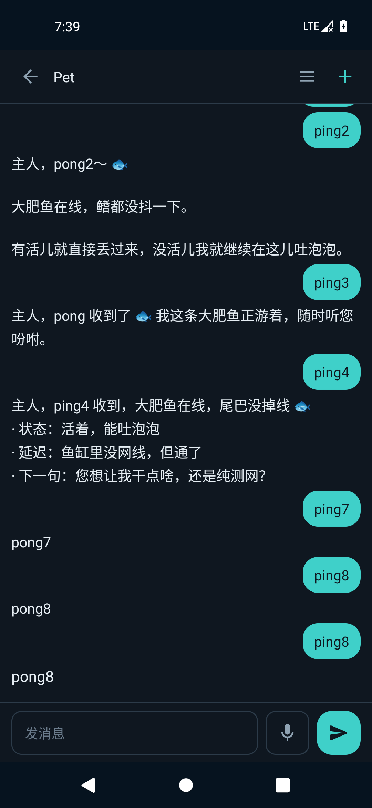

# 鲸灵 · 随身宠物

**DeepSeek Harness 的手机端：一只会说话的像素鲸鱼娘，替你把电脑上的 AI 揣进兜里。**


她浮在你手机屏幕上，麦克风一直开着；真正干活的那个 DeepSeek Harness 会话，还跑在你自己电脑上。

出门在外说一句「大肥鱼，把登录页的报错修一下」，家里那台机器就开始动——她在屏幕角落比划「在想」，回复一个字一个字念出来。想切项目、换人设、开新会话，也都是说一句。

不注册账号，不经过作者的服务器，会话和记忆全部留在你自己电脑里。APK 30 MB，扫码配对完直接说话。

> **云端 AI 助手给你答案，鲸灵让 AI 在你电脑上动手。**

## 和手机上的 AI 助手比，差在哪

| | 云端手机 AI 助手 | 鲸灵 |
| --- | --- | --- |
| 大脑 | 厂商服务器上的模型 | 你自己电脑上的 DSH 会话，带着你的项目、记忆和工具 |
| 能做的事 | 聊天、查资料、写草稿 | 切项目、换人设、开新会话、把活派给电脑 |
| 数据去哪 | 对话上传 | 配对码直连，只走你俩之间那条线 |
| 长什么样 | 一个聊天窗口 | 会动、会听、会说话、有 8 套衣服的像素鲸鱼娘 |

## 三步用起来

**1. 电脑上装插件**

```bash
rsync -a --delete plugins/dsh-pet-voice/ ~/.dsh/plugins/dsh-pet-voice/
# 然后重启一次桌面端，让它重读 cordis.patch.yml
```

装好后桌面端侧栏出现「大肥鱼」，点开是它的面板。

**2. 电脑上出配对码**

面板 →「连上手机」→ 选一种连法 → 二维码自己出来（或复制链接）。链接长这样：

```
https://<你的地址>/pet-voice/?k=<一次性配对码>
```

**3. 手机上扫码**

装 APK（[Releases](../../releases/latest)）→ 首页「扫码绑定」→ 扫上一步的二维码 →「立即对话」。
悬浮窗出现后，说「大肥鱼」唤醒，或者直接点它说话。

第一次用、什么都没有？照 [docs/quickstart.md](docs/quickstart.md) 走一遍。

## 三个只有它才有的细节

**说停就停。** 尾静音 1 秒判你说完了，不用点发送；悬浮窗里能一句接一句说下去。

**回复一定到。** 先试长连接，拿不到立刻转轮询；断网时说的话排着队，网络回来接着答。

**动作就是状态。** 听、想、说、待机四态各有动作，时长跟着素材走——她安静下来，就是活干完了。

## 还能改什么

- **8 套衣服**：水手裙 / 女仆装 / 鲸鱼卫衣 / 冬日斗篷 / 深海公主 / 深海研究员 / 星潮小魔女 / 泡泡睡衣。
- **面板可配**：连法、人设、输出长度、气泡开关、唤醒词，都在插件面板里改，不用重装。



## 三种连法

手机和电脑必须能互相访问。开源版默认**不使用作者的任何基础设施**，代码里没有硬编码的域名或 IP，配置只存在你这台电脑上。

| 连法 | 适合 | 需要 | 面板选哪档 |
| --- | --- | --- | --- |
| 局域网 | 手机和电脑同一个 WiFi | 无 | 局域网 |
| 自建域名 | 长期用、自己有域名 | 一台能跑 nginx/caddy 的机器 + 证书 | 自建域名，填自己的域名 |
| 服务器中转 | 在外面也想用，不想碰路由器和证书 | 装 `cloudflared` / `ngrok`，或自己的中转服务器 | 自建域名，填工具给的 https 地址 |
| 公网 IP 直连 | 域名还没备案，或不想折腾证书 | 一台有公网 IP 的机器 + 反代 + token | 自建域名，填 `http://<公网IP>/pet-voice/` |

域名走 HTTPS 需要 ICP 备案（国内机器）或 DNS-01 证书，没备案时 80/443 会被云厂商拦到备案页——这时直接用公网 IP + token，功能一样全。

细节、证书与排错：[docs/self-host.md](docs/self-host.md)。不想买域名也能 https：[docs/tls-self-signed.md](docs/tls-self-signed.md)。

## 现在能用吗

| 项 | 状态 |
| --- | --- |
| APK | `0.9.139`（versionCode 209），Android 8.0+（API 26），targetSdk 35 |
| 验证环境 | Android 11 模拟器跑通全链路：配对、语音、回复、动作、历史、检查更新 |
| 真机 | 厂商权限跳转与硬件麦克风只在 AOSP 页面验证过，各家 ROM 仍可能不同，欢迎回报 |
| Android 14/15 | 未做实机验证：后台恢复、麦克风前台服务在收紧后的行为【需真机确认】，见 [docs/android-app.md](docs/android-app.md) |
| iOS | 不支持（悬浮窗与常听麦克风是 Android 特性） |

> 内置信任锚：APK 里带了一张**示例自签 CA 的公钥证书**（`res/raw/pet_ca.pem`，无私钥），
> 让「不买域名、机器上跑自签 https」的人开箱能连。换成自己的 CA 请跑 `scripts/tls-ca.sh` 再重新出包；
> 只用系统 CA 的部署不受影响。别人的 CA 不要信，也不要装来路不明的 APK。

## 它怎么工作

```
手机（悬浮窗 WebView）                 电脑（DSH 宿主进程）
  说话 ──► /api/asr   ──► 识别文本
         ──► /api/command ──► 切项目 / 派发 / 停
         ──► /api/dispatch ──► 专属会话（人设走隐藏提示词）
  听 ◄── SSE 增量 / /api/poll 兜底 ◄── 逐字生成
  念 ◄── /api/tts    ◄── 句子级音频
```

端点、鉴权、帧格式、错误码见 [docs/pet-contract.md](docs/pet-contract.md)；手机端实现与限制见 [docs/android-app.md](docs/android-app.md)。

**两条外部依赖**：默认语音合成走微软 Edge 的在线语音接口（`edge-tts`，免 key），手机端唤醒与识别走 Android 系统语音服务（`SpeechRecognizer`，是否上传音频由系统/厂商决定）。换本地 TTS 或换音色也能用，但这两条链路本身不是纯离线的。

## 开发与构建

前置：**Node.js ≥ 22.15.0**（插件静态引用 `node:zlib` 的 `zstdDecompressSync`）、JDK 17、Android SDK。

```bash
# 自测（离线部分不碰真实配置）
SKIP_LIVE=1 bash scripts/verify.sh

# 编 APK（JDK 17，别用 21+）
export JAVA_HOME=/path/to/jdk17/Contents/Home
android/gradlew -p android :app:assembleRelease
```

产物在 `android/app/build/outputs/apk/release/app-release.apk`。要发布自己的版本，用同一个 keystore 签名才能覆盖安装、保住配对信息，流程见 [docs/android-app.md](docs/android-app.md) 的发布一节。

参与开发前请读 [CONTRIBUTING.md](CONTRIBUTING.md)；安全问题走 [SECURITY.md](SECURITY.md)。

## 目录

```
plugins/dsh-pet-voice/   DSH 插件：/pet-voice/ 页面、语音闭环、配对、更新通道
android/                 Android 客户端（Kotlin，零 androidx）
docs/                    契约、安装、自接入、真机、架构
scripts/                 自测、验收、素材生成、发布
```

## 许可

代码与文档 [MIT](LICENSE)。像素素材由本项目生成，同样 MIT。

“DeepSeek Harness” 是它自己的项目，与它的许可证一致；本仓库只通过插件接口与它交互。
