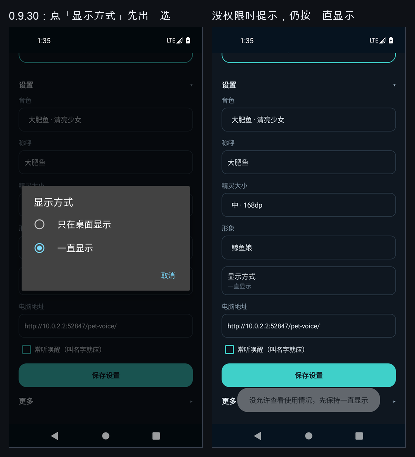
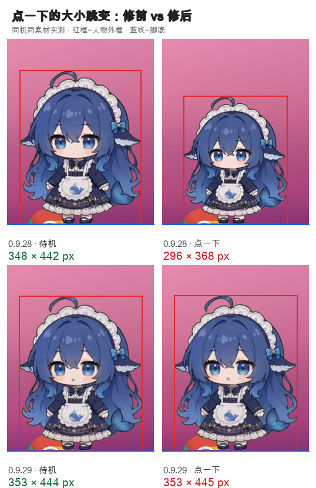
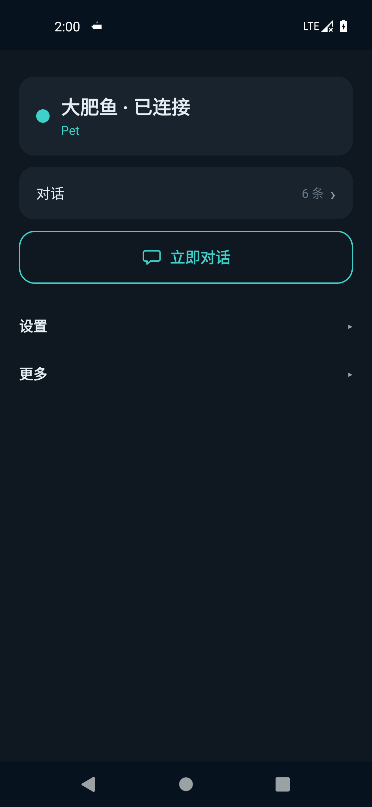
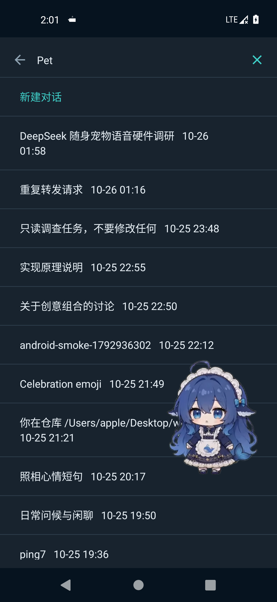
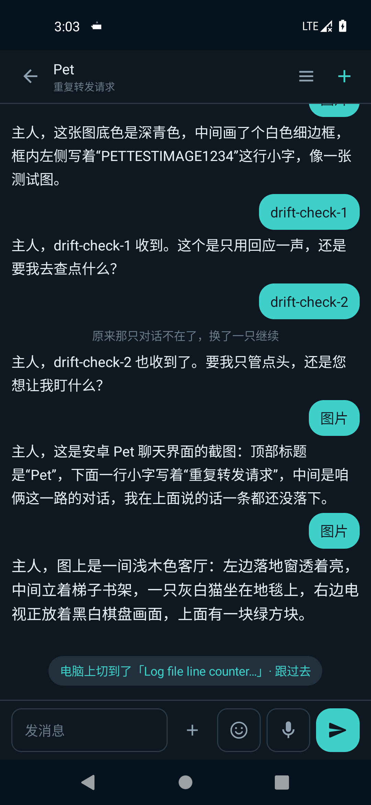

# 鲸灵 · Android 端（MVP）

原生 Android 壳：悬浮窗（WebView 形象 + 原生字幕）+ 双击说话 + 语音唤醒 + 一轮对话（服务端 ASR 未上线，走本机系统识别）+ 服务端逐句 TTS。

- 包名：`com.whale.pet`；minSdk 26 / targetSdk 35 / compileSdk 35
- APK：`android/app/build/outputs/apk/debug/app-debug.apk`（944,073 B，debug 签名）
- 构建：AGP 8.12.0 + Gradle 8.13 + Kotlin 2.0.21 + JDK 17，**零外部依赖**（只用平台 API + Kotlin stdlib）

---

## 1. 权限清单（AndroidManifest 实际声明）

| 权限 | 用途 | 不授予的后果 |
| --- | --- | --- |
| `INTERNET` | 访问宿主 `/pet-voice/api/*` | 完全不可用 |
| `RECORD_AUDIO` | 系统 `SpeechRecognizer` 采集语音 | 双击说话无输入，只能用文字通道 |
| `SYSTEM_ALERT_WINDOW` | `TYPE_APPLICATION_OVERLAY` 悬浮窗 | 无悬浮窗（服务只能挂着通知） |
| `FOREGROUND_SERVICE` | 常驻服务 | 无法常驻，退到后台即被杀 |
| `FOREGROUND_SERVICE_MICROPHONE` | 用户主动启动时用 microphone 类型 | 启动时被系统拒（`startForeground` 抛异常） |
| `FOREGROUND_SERVICE_SPECIAL_USE` | 开机/重启恢复时用 specialUse 类型（不碰麦克风） | 开机恢复失败 |
| `POST_NOTIFICATIONS`（33+） | 「鲸灵在听」常驻通知 | 服务仍跑，但通知不可见、无法从通知停止 |
| `RECEIVE_BOOT_COMPLETED` | 开机恢复悬浮窗 + 通知 | 重启后需手动打开 App |
| `WAKE_LOCK` | 说话/播放期间保持唤醒 | 熄屏即断 |
| `REQUEST_IGNORE_BATTERY_OPTIMIZATIONS` | 请求「省电策略 → 无限制」 | 系统会在后台清掉服务 |

`<queries>`：`android.speech.RecognitionService`、`android.speech.action.RECOGNIZE_SPEECH`（Android 11+ 包可见性，否则 `isRecognitionAvailable()` 恒为 false）。

实测（`aapt2 dump xmltree`）：

```
E: service (line=53)
  A: android:name="com.whale.pet.FloatingPetService"
  A: android:exported=false
  A: android:foregroundServiceType=0x40000080     # specialUse(1<<30) | microphone(0x80)
  E: property  android.app.PROPERTY_SPECIAL_USE_FGS_SUBTYPE = "floating whale pet overlay ..."
```

签名实测（`apksigner verify --print-certs`）：`C=US, O=Android, CN=Android Debug`，SHA-256 `714376ad2cccf90af6f2aafcd971201871dc661da40611ff3c4cdb14fd063840`。

---

## 2. 一轮对话时序（语音路径）

```
双击悬浮窗
  └─ PetFrame.onDoubleTap（服务里注册，拖动阈值 8px，双击 ≤300ms）
      └─ NativeAsr：SpeechRecognizer + RecognizerIntent
            EXTRA_LANGUAGE=zh-CN, EXTRA_PARTIAL_RESULTS=true, 静音 1200ms 收尾
            onPartial → 悬浮窗字幕实时刷新
            onFinal   → beginTurn(text)
                └─ PetTurn.start()（后台线程 pet-turn）
                     ├─ 先开 SSE：GET /pet-voice/api/stream?sessionId=（≤5s 等 hello）
                     │     hello 到了才 POST /pet-voice/api/dispatch {"text": ...}   ← 纯原文，不加人设前缀，避免污染会话历史
                     │     SSE 事件：start / delta / message / tool / final / end / error / say（`: hb` 15s 心跳，retry:1500）
                     │     隧道掐掉 SSE → 立刻退回 GET /api/poll?sessionId=&cursor=-1&wait=（先取基线再派发，不丢帧）
                     ├─ 累积 assistant 文本 → onAssistant → 悬浮窗字幕（150ms 节流；final 强制刷）
                     ├─ 句子切分：。！？!?；;\n，长句 > 90 字按逗号再切 → onSentence
                     │     └─ TtsPlayer：每句 POST /pet-voice/api/tts?text=&preset=whale|genki|gentle|cool
                     │           音频缓存 cacheDir/tts/<ts>_<seq>.mp3（audio/mpeg，24kHz 48kbps）
                     │           ArrayDeque 排队 → 单线程下载 → 主线程顺序 MediaPlayer（一句播完再下一句，不叠音）
                     └─ end 后 1.5s 宽限 或 final 立即收尾 → onDone → 回「待机 · 双击说话」
                        （判定本轮结束只看 end；message 是过程消息，final/end 只在官方 turn/end 发）
```

关键约束：

- **Android WebView 没有 `webkitSpeechRecognition`**（宿主页面 `public/app.js` 里那段在 Android WebView 里是 undefined）。所以 WebView 只负责形象与字幕，说话必须是原生 `SpeechRecognizer`；不能用 `evaluateJavascript` 绕过去。
- 页面文件不改：悬浮窗注入一段 CSS（隐藏面板/聊天/输入框，只留 `#pet`/`#say`），字幕通过 `#say` 的 `textContent` 与 `data-mood` 属性驱动；页面加载失败（注入后检测不到 `#pet`/`#mic`）时退到 `ImageView` 静态形象 + 原生字幕。
- Cookie 注入：`CookieManager.setCookie(baseUrl, "pkv_<token前8位>=<token>")` + `flush()`，页面刷新不用重新配对。
- 宿主没有 `/api/asr`，服务端识别未上线；本机识别不可用时走**文字通道**（见 §3）。

---

## 3. 文字通道（识别不可用时的兜底，已实现）

设置页「4. 文字通道」：`EditText` → 「发送文字并朗读回复」→ 与语音**完全同一条链路**（`PetTurn`：dispatch → stream/poll → 逐句 TTS），回复同时显示在 `replyView` 并朗读。模拟器上用真令牌实跑成功，原文见 §7.2。

自检页（「测试连接 / 设备自检」）打印三行真实值：

```
系统识别 isRecognitionAvailable: false
createSpeechRecognizer: null
RECOGNIZE_SPEECH 命中 Activity: 0 个
→ 这台机器没有可用的系统识别，请改用「服务端识别」（未上线）或安装语音服务；现在可以用下面第 4 节的文字框直接对话。
```

三项任一不满足都会打出这行提示，不假装能说话。

---

## 4. 唤醒词选型

接口在 `WakeWordEngine.kt`，可替换：

```kotlin
interface WakeWordEngine {
    val id: String
    fun isAvailable(): Boolean
    fun setListener(l: (WakeHit) -> Unit)
    fun start(); fun stop()
}
data class WakeHit(val word: String, val rest: String)
```

当前实现 `NativeSpeechWakeWordEngine`（id `native-speech`）：循环起 `SpeechRecognizer`（zh-CN、partial），命中「鲸灵 / 小鲸」触发 `WakeHit`，其余文本当作 `rest` 直接对话。`WakeWordEngines.create()` 是唯一装配点，第二轮换成离线 KWS 时只改这一处。

- **不用 Porcupine**（商业授权 + 需要 AccessKey）。
- 第二轮候选：**sherpa-onnx** 离线 KWS（`sherpa-onnx-kws-zipformer-*`，中文唤醒词可自定义拼音 token；模型量级约 15–30 MB，需把 onnxruntime AAR 打进 APK，会显著增大包体）与 Vosk 小模型对比。要量的指标：唤醒率 / 误唤醒率（安静房间 vs 电视人声各 1 小时）/ 常驻耗电（mAh/h）/ APK 增量。
- 这一轮的现实限制：系统识别器在后台被 HyperOS 限流时唤醒会静默失效（见 §5）；`maybeStartWake()` 已做成「非说话/非轮次中才起、权限缺失直接跳过、无识别器时显示『唤醒不可用：无识别器』」。

---

## 5. 各品牌手机装机必做（0.9.4 起统一入口）

首页「更多 → 去授权」弹四项，点哪项就跳到**这台手机自己的系统页**。不再按品牌摆固定按钮，也不写死某家包名。

| 项 | 语义 | 落到哪 | 不给的后果 |
| --- | --- | --- | --- |
| 悬浮窗权限 | `SYSTEM_ALERT_WINDOW` | `ACTION_MANAGE_OVERLAY_PERMISSION(package:)` → 裸 action → App 详情 | 没有悬浮窗，只剩通知 |
| 电池不受限 | 免省电优化 | `ACTION_REQUEST_IGNORE_BATTERY_OPTIMIZATIONS(package:)` → `ACTION_IGNORE_BATTERY_OPTIMIZATION_SETTINGS` → App 详情 | 息屏几分钟被杀 |
| 自启动 | 厂商启动管理 | 小米 `OP_AUTO_START` / 华为·荣耀 启动管理 / OPPO `StartupAppListActivity` / vivo `BgStartUpManager` / 三星 `BatteryActivity` / 魅族 `PermMainActivity` / 华硕 `AutoStartActivity` → App 详情 | 重启后悬浮窗不恢复 |
| 通知 | 通知开关 | `ACTION_APP_NOTIFICATION_SETTINGS(EXTRA_APP_PACKAGE)` → App 详情 | 常驻通知不可见 |

- 首页有跳转前判空（`resolveActivity`），Android 11+ 需要 `AndroidManifest.xml` 里的 `<queries>` 才能探测到厂商包，否则必然判成 null 而落到 App 详情页。
- 麦克风不在这四项里：首次开悬浮窗说话时弹系统窗，`POST_NOTIFICATIONS` 在 Android 13+ 由 `launchPet()` 自己申请一次，拒绝不阻塞服务。
- 状态回看：首页「诊断」逐行给出悬浮窗 / 麦克风 / 通知 / 省电策略的当前值。

### HyperOS / MIUI 额外两项（跳转已覆盖，但是系统里的独立开关）

| 开关 | 路径（HyperOS 4，可能微调）【需真机确认】 | 不开的后果 |
| --- | --- | --- |
| 后台弹出界面 | 设置 → 应用设置 → 应用管理 → 鲸灵 → 权限管理 → 后台弹出界面 | 从后台/通知拉起悬浮窗被拦，双击无反应 |
| 省电策略 | 设置 → 应用设置 → 应用管理 → 鲸灵 → 省电策略 → 无限制 | 息屏后服务被清 |

### 开机恢复策略（重要）

`BootReceiver` 只发 `ACTION_RESTORE`：服务以 **specialUse** 类型 `startForeground`，恢复悬浮窗 + 常驻通知，**不申请麦克风、不启动唤醒**。

原因：Android 14+ 禁止从后台（含 `BOOT_COMPLETED`）启动 microphone 类型的前台服务，硬起会 `SecurityException`，服务直接被拒；等用户自己双击悬浮窗后再走识别（`ACTION_START` 才用 microphone 类型，并在失败时降级 specialUse）。系统 `START_STICKY` 把进程拉回时 `intent == null`，同样按恢复模式处理（不碰麦克风）。

---

## 6. 已知限制（写给下一位，不粉饰）

1. **WebView 不能在后台录音**：页面里 `webkitSpeechRecognition` 在 Android WebView 是 undefined；录音只能走原生 `SpeechRecognizer`（系统识别器进程），悬浮窗里的页面拿不到麦克风。
2. **服务端 ASR 已上线（`/api/asr`）**：宿主侧接口齐了（`/api/dispatch`、`/api/stream`、`/api/poll`、`/api/tts`、`/api/say`、`/api/asr`、`/api/pair`、`/api/cancel`、`/api/command`、`/api/state`、`/api/diag`、`/api/update`、`/api/projects`、`/api/sessions`、`/api/session`、`/api/goals`、`/api/log`、`POST /api/new`）。文字通道是断网兜底，全链路已在模拟器跑通（见 §7.2）。
3. **各 ROM 悬浮窗差异【未实测】**：`TYPE_APPLICATION_OVERLAY` 在 HyperOS 上可能被「后台弹出界面」二次拦截，也可能限制窗口尺寸/圆角；小米系对 `FLAG_NOT_FOCUSABLE` 的窗口触摸透传行为与 AOSP 有差异。均需真机验证。
4. **没有用 EncryptedSharedPreferences**：`androidx.security:security-crypto` 不在离线缓存里，无法 `--offline` 构建；当前令牌存 `MODE_PRIVATE` SharedPreferences，界面上只显示掩码（`已保存 · ••••••••（长度 N，不显示明文）`，永不回显明文）。下一步补加密存储（或自行用 Android Keystore + AES-GCM，不引依赖）。
5. **未在真机验证**：`adb devices` 无设备（只有模拟器 AVD `nr1` = Pixel 5 API 30，非 HyperOS）。HyperOS 4 的路径/开关名、后台限流强度、语音识别器可用性全部【需真机确认】。模拟器实测 `isRecognitionAvailable()=true`、`RECOGNIZE_SPEECH` 命中 1 个 Activity，但无声卡输入，双击后落在「没听清，再双击」的错误分支。
6. **TTS 依赖宿主 edge-tts venv**：venv 缺失时 `/api/tts` 返回 503，App 只显示字幕、`onTtsError` 提示「语音不可用」。
7. **唤醒循环耗电/误唤醒未量化**：系统识别器轮询本身有开销，第二轮换 sherpa-onnx 再测。

---

## 7. 构建与安装（离线）

```bash
JAVA_HOME=~/jdk17/Contents/Home ~/.gradle/wrapper/dists/gradle-8.13-bin/*/gradle-8.13/bin/gradle \
  -p android :app:assembleDebug --offline \
  -Pandroid.aapt2FromMavenOverride=/opt/homebrew/share/android-commandlinetools/build-tools/35.0.0/aapt2
```

- 三部分缺一不可：JDK 17（PATH 里没有 java，必须显式 `JAVA_HOME`）、`--offline` + 本地 Maven 仓库 `/tmp/m2flat`（`settings.gradle.kts` 里第一优先，1196 个标准布局软链）、`aapt2` 覆盖到 build-tools 35.0.0 真实二进制（缓存里的 aapt2 只有 `-linux.jar`）。
- 产物：`android/app/build/outputs/apk/debug/app-debug.apk`（944,073 B）。
- 安装（真机）：`adb install -r app-debug.apk`；无设备时仅能 `aapt2 dump badging` + `apksigner verify` 做静态校验。

模拟器冒烟（已在 AVD `nr1` / Pixel 5 API 30 arm64 上实际执行）：

```bash
emulator -avd nr1 -no-window -no-audio &
adb install -r android/app/build/outputs/apk/debug/app-debug.apk      # Performing Streamed Install / Success
adb shell appops set com.whale.pet SYSTEM_ALERT_WINDOW allow
adb shell pm grant com.whale.pet android.permission.RECORD_AUDIO
# API 30 没有 POST_NOTIFICATIONS（33+ 才有），这条会报 Unknown permission，属预期
```

### 7.1 冒烟结果（实测输出）

| 项 | 实测 |
| --- | --- |
| 前台服务 | `isForeground=true foregroundId=4101`，`channel=pet_listen` |
| 常驻通知 | `android.title=鲸灵在听`，`android.text=双击悬浮窗说话 · 点按设置` |
| 悬浮窗 | `mAttrs={(552,1148)(495x660) … ty=APPLICATION_OVERLAY}`（495×660 px @2.75 = 180×240 dp） |
| 双击 | 字幕变「再说一次」、状态「没听清，再双击」（进入 ASR 分支，无声卡输入 → 优雅失败） |
| 自检三值 | `isRecognitionAvailable: true` / `createSpeechRecognizer: 非 null` / `RECOGNIZE_SPEECH 命中 Activity: 1 个` |
| WebView | `com.google.android.webview` |
| 省电策略 | `受限（可能被杀）`（模拟器默认，未做白名单） |
| 文字通道 | 真令牌一轮成功（见下） |

### 7.2 文字通道全链路（真令牌，已跑通）

令牌注入方式（**令牌不进命令行、不打印**）：本地 `umask 077` 生成 `pet_prefs.xml` → `adb push` 到 `/data/local/tmp` → `adb shell run-as com.whale.pet cp` 到 `/data/data/com.whale.pet/shared_prefs/pet_prefs.xml` → 立刻删除两个临时文件 → `am force-stop` + `am start`。App 读到后只显示掩码：`tokenState → 已保存 · ••••••••（长度 48，不显示明文）`。

输入 `hello-from-emulator-please-reply-in-one-short-sentence` 后点「发送文字并朗读回复」，25 秒后 `uiautomator dump` 取到的 `replyView` 原文：

```
我：hello-from-emulator-please-reply-in-one-short-sentence
鲸灵：Hello from the emulator — the bridge is connected and working.  🔊
```

即 **App → `/api/dispatch` → SSE（`/api/stream`）→ 句子切分 → `/api/tts` → 顺序 `MediaPlayer`** 在模拟器上闭环（前提：宿主 `52356` 在跑）。末尾 🔊 是 `TtsPlayer.onSpeaking(true)` 的回调痕迹。

服务端同批复验：`/api/state` → `ok=true`、`presets` 四项齐全、`current` 有值，**响应体不含 token**；`/api/tts?text=你好&preset=whale` → `http=200 bytes=7920`；`/api/pair` → `source:"tunnel"` + trycloudflare 地址。

截图（本次冒烟）：`/tmp/pet-main.png`（设置页）、`/tmp/pet-overlay2.png`（悬浮窗 + 401 兜底静态形象）、`/tmp/pet-dbltap2.png`（双击后「没听清，再双击」）、`/tmp/pet-selfcheck2.png`（自检输出）。

---

## 8. 代码地图

| 文件 | 职责 |
| --- | --- |
| `MainActivity.kt` | 设置页：宿主/令牌/音色、配对链接导入、自检（ASR 三值 + 连接测试）、文字通道、HyperOS 4 项跳转、启动/停止服务 |
| `FloatingPetService.kt` | 前台服务：悬浮窗、WebView 注入与 Cookie、双击/拖动、ASR、唤醒循环、一轮对话、TTS 队列、通知；`ACTION_START/STOP/RESTORE` |
| `PetFrame.kt` | 自定义 `FrameLayout`：双击/单击/拖动（8px 阈值，按钮区域排除） |
| `PetTurn.kt` | 一轮对话：SSE 优先 + poll 兜底、句子切分 |
| `PetClient.kt` | `HttpURLConnection` 客户端：state/dispatch/poll/stream/tts/cancel |
| `TtsPlayer.kt` | 逐句 TTS：队列 + 单线程下载 + 顺序 `MediaPlayer` |
| `NativeAsr.kt` | 单次 `SpeechRecognizer`（zh-CN、partial、静音 1200ms） |
| `WakeWordEngine.kt` | 唤醒词接口 + 系统识别器实现（鲸灵/小鲸） |
| `Settings.kt` | `PetConfig` / `PetSettings`（SharedPreferences，令牌掩码显示） |
| `BootReceiver.kt` | 开机/升级 → `ACTION_RESTORE`（只恢复悬浮窗 + 通知，不碰麦克风） |

## 9. 悬浮窗＝只有精灵本体（无卡片 / 无按钮 / 无底栏）

- 窗口里**只有一个全透明 WebView**（`overlay_pet.xml`，`PixelFormat.TRANSLUCENT`），不画卡片、状态、按钮、底板；
  `grep` 旧字符串（`鲸灵在呢`/`点我说话`/`minimize`）在布局里为 0 命中。
- WindowManager 参数：`TYPE_APPLICATION_OVERLAY`、`gravity=TOP|START`、
  `FLAG_NOT_FOCUSABLE | FLAG_NOT_TOUCH_MODAL | FLAG_LAYOUT_NO_LIMITS`、`x/y` 贴右下角（不挡状态栏）。
- **触摸代理**（不是卡片上的按钮）：根 `FrameLayout` 与 WebView 都挂 `OnTouchListener`
  （WebView 会自己吃掉 `DOWN`，只挂根布局会全部失效——这是本批实测踩到的坑）。
  - 位移 ≤ 8dp 且时长 < 500ms → 点一下 = 唤醒说话；
  - 位移 > 8dp → 拖动（16ms 合并一次 `updateViewLayout`，不重建 WebView）；
  - 按住 500ms → 打开「对话记录」（`HistoryActivity`）；
  - 没有双击语义，避免和「点一下唤醒」抢事件。
- 尺寸三档（`PetConfig.SPRITE_SIZES`）：120 / 168 / 200 dp，窗口高度 = 尺寸 + 48dp 给气泡留位；
  改尺寸走 `applyWindowSize()` → `updateViewLayout`，**WebView 只创建一次**。
- 窗口里不出现任何文字状态（「正在听/思考」用形象动作表达，错误只做 `happy` 900ms 再回 idle）。

### 9.1 显示方式：只在桌面 / 一直显示

- 两种模式，默认 `一直显示`。`只在桌面显示` 要靠「查看使用情况」权限判断前台是不是桌面
  （`UsageAccess.granted()` 读 `OPSTR_GET_USAGE_STATS`；个别 ROM 不认这个 op 就当已允许，
  宁可按桌面显示，也不能把小人整个藏没），服务侧判定在 `FloatingPetService.kt:379` 附近。
- **点「显示方式」永远先弹二选一**，选「只在桌面显示」才要权限：缺权限就跳系统
  「使用情况数据」页并记住这次选择，`onResume` 回来若已授权就自动落库 + `ACTION_REFRESH`，
  没授权则提示「没允许查看使用情况，先保持一直显示」（0.9.29 及以前是点行就直接跳系统页，
  用户看不到选项，很容易以为点错了）。
- 设置行的值：`在桌面时出现` / `一直显示`；模式是 `home` 但权限被撤回时显示
  `一直显示（授权后生效）`——因为服务此刻确实按一直显示跑。



## 10. 形象与动画（渲染层）

形象**不是代码画的**：`dsh-pet` **0.3.8** 自带 **106 段**角色动画，原片 640×360 / VP9 / `ALPHA_MODE=1` / 24fps / 每段 10.04s。
本批取 **13 段**转码成 420×465、**10fps**、带 alpha 的 webm，放 `android/app/src/main/assets/anim/`，
由 overlay 里的两路 `<video>` 交叉淡化播放：`idle` / `thinking` / `talking` / `cheer` / `tap` / `tap_shy` /
`tap_pout` / `tap_tickle` / `look_around` / `yawn` / `curtsy` / `wake_up` / `drag`。

> 帧率先用的 15fps，模拟器软解下单核 23%；降到 **10fps** 后 15.8%，呼吸动作仍连贯。
> 后来加了待机小动作（`look_around` / `yawn` / `curtsy`）与一次性动作，复测 **18.2%**（2026-10-24 20:44，含一次切换淡化）。

### 10.1 取帧的坑（踩过，下一位别再踩）

- ffmpeg 默认解码出来的 `pix_fmt` 是 **yuv420p，alpha 直接丢**；必须显式 `-c:v libvpx-vp9` 解码才能拿到 RGBA（alpha 0–255）。
- `-vf alphaextract` 在这批文件上报 **`Requested planes not available`**（根本没有 alpha 平面可抽），不能用来查蒙版。
- 640×360 帧里真正的角色内容只有 **(213,62)-(426,330)**，四周都是 alpha≈1 的透明；所以统一裁 **280×310 @ (180,35)** 再放大到 420×465，
  不然 contain 之后人物会缩成一小坨。

### 10.2 编码参数与体积

```bash
-c:v libvpx-vp9 -pix_fmt yuva420p -b:v 220k -deadline good -cpu-used 2 -row-mt 1 -an   # 10fps
```

13 段合计 **2,427,042 B（2.31 MB）**，最大五段：`idle` 270,345 B / `talking` 255,553 B / `cheer` 231,373 B / `tap` 230,461 B / `thinking` 180,517 B（2026-10-24 `ls` 实测）。
APK 因此从 **1.96 MB 长到 debug 3,674,327 B / release 3,388,437 B**（0.2.0 签名包，release 略小是因为去掉了调试信息）。

### 10.3 渲染与合成（关键结论）

- overlay 里两路 `<video class="pet-video">` 交叉淡化，`opacity` 过渡 **0.16s**，`object-fit: contain`。
- **视频表面在 `TYPE_APPLICATION_OVERLAY` 窗口里能正常合成**：`adb exec-out screencap` 与
  `screenrecord` 抽帧都能拍到人物（两者均已实测）。
- 但是 **CDP `Page.captureScreenshot` 截不到视频层，会返回 alpha 全 0 的空 PNG**（同页 `readyState=4 / paused=false / videoWidth=420` 都正常）。
  这条曾导致误判成「overlay 没合成、形象没出来」。**验证形象一律用 `screencap` 或 `screenrecord`，不要用 CDP 截图。**
- 单位换算：WebView 里 **1 CSS px = 1 dp**（density 2.75 自动放大）。窗口 462×594 设备 px = **168×216 dp**。
  把 `50px` 当成设备 px 写，气泡就会变成 137dp 高、把形象压没。

### 10.3.1 尺寸一致性：按「人物主体」归一，不按整段包围盒

`NORM` 是每段素材的**全内容源矩形**（整段所有帧的并集），`BODY` 是**人物主体框**
（逐帧取「行宽 ≥ 该帧最宽行 30%」的行区间，跨帧取中位）。旧实现只有一张表、而且是早先离线量的并集，
其中好几个动作的高度量成了满画布；叠上「按并集归一」的算法，人物显示高度就逐动作飘：

| 动作 | 旧表高 | 实测内容高 | 主体高 | 旧缩放 | 修前人物高（画布单位） | 占待机 |
| --- | --- | --- | --- | --- | --- | --- |
| `idle` | 407 | 405 | 346 | 1.000 | 346 | 100% |
| `talking` | 405 | 403 | 342 | 1.005 | 344 | 99% |
| `tap_shy` | 401 | 399 | 337 | 1.015 | 342 | 99% |
| `tap` | 442 | 440 | 339 | 0.921 | 312 | 90% |
| `tap_wave` | 407 | 379 | 292 | 1.000 | 292 | 84% |
| `sleep` | 414 | 358 | 289 | 0.983 | 284 | 82% |
| `startle` | 465 | 385 | 296 | 0.875 | 259 | 75% |
| `tap_joy` | 465 | 379 | 284 | 0.875 | 249 | 72% |

`startle`/`tap_joy` 的旧表高 465 就是画布全高（整段真实内容只有 385/379），这两个动作被压到待机的 72–75%，
而 `ONCE.tap` 里正好有它们，所以「点一下明显变小」。

实测（同一台模拟器、同一尺寸档；红框=人物外框、蓝线=脚底）：



0.9.28 待机 348 × 442 px → 点一下 296 × 368 px（矮 17%）；0.9.29 待机 353 × 444 px → 点一下 353 × 445 px。

现在的做法：缩放和脚底锚点只看 `BODY`，源矩形仍用 `NORM`（不裁气泡和尾巴）。`TARGET_H = 346` 就是用户
看惯的待机高度，所以待机几乎没动；`TARGET_BOTTOM = 444` 贴地、`TARGET_CX = 210` 居中，缩放夹在 `[0.85, 1.30]`。
23 段动作的「常见帧人物高」统一到 346 单位；逐帧仍随姿势起伏（蜷着睡、跳起来本来就矮一截），那是画本身，不去压平。

- 两张表都是**量出来的**，别手调：`python3 scripts/sprite-norm.py --check`（需 `ffmpeg`）按**原生帧率**解帧
  ——抽帧会漏掉「头发丝、星星特效冲出画布」那几帧，框量小了播到那几帧就是硬裁；帧尺寸取 `ffprobe` 的
  真实几何（素材是 420×464，别按画布 465 硬编码，行距错一拍整段包围盒都会虚高）；并集按 α≥128、每行≥2 px 计，
  主体框按行宽 ≥ 该帧最宽行 30% 计；复算每段「显示高」，偏差超过 3% 或超出可见区就报错并非 0 退出。
  `--write` 会按当前素材重写 `NORM`/`BODY`。
- `scripts/verify.sh` 第 1b 步跑这个检查（没装 ffmpeg 就 SKIP），换素材后不用靠肉眼发现体型跳变。
- 横向只保证内容不出画布：`cheer` 素材本身就是 420 全宽，缩放 1.012 后两边各裁约 2.5 单位（想完全不裁就得让整只往左偏）。

### 10.4 状态映射（`setMode` 一处收敛）

| 状态 | 触发 | 播放 | 表现 |
| --- | --- | --- | --- |
| idle | 待机 / 一轮结束 | `idle.webm` | 静止；`setAutoPlay(true)` 时自己玩 |
| listening | 点一下 / 唤醒后开识别 | `idle.webm` | 待机（气泡收起） |
| thinking | 请求已发出、等首句 | `thinking.webm` | 思考表情，无气泡 |
| talking | 首句 / 开始播 TTS | `talking.webm` | 播放速率随 `setMouth(0..1)` 在 **0.92–1.18** 之间变 |
| happy | 错误兜底 900ms | `cheer.webm` | 欢呼一下再回 idle |
| tap | 点一下的立即反馈 | `tap.webm` | 一次性，播完回当前状态，**4.5s 兜底** |

### 10.5 渲染桥（`window.PetBridge`，原生只用 `evaluateJavascript` 调，`pageReady` 之后才发）

| 方法 | 作用 |
| --- | --- |
| `setMode('idle'|'listening'|'thinking'|'talking'|'happy')` | 切状态（内部换视频源） |
| `say(text)` | 头顶气泡；`say('')` 收起；>90 字截断 |
| `setWho(name)` | 气泡署名 = App 里的自定义称呼 |
| `setMouth(0..1)` | 口型 → 播放速率 0.92–1.18；`TtsPlayer.mouth()` 200ms 一次、变化 >0.15 才发 |
| `setAutoPlay(bool)` | 待机自己玩开关 |
| `action('tap'|'celebrate')` | 一次性动作 |

### 10.6 布局与气泡间距

- 窗口尺寸 = `精灵尺寸 × (尺寸 + 48dp)`（120 / 168 / 200 dp 三档，`PetConfig.SPRITE_SIZES`）。
- 模板：`#bubble { max-height: 45% }`，`body.has-bubble #stage { top: var(--shift, 52px); transition: top .18s }`
  —— **气泡出现时形象整体下移让位，让位量由 JS 按气泡实测高度算出**，窗口本身不加高：
  overlay 是 `FLAG_NOT_TOUCH_MODAL`，窗口内区域会吃掉触摸，加高窗口就是屏幕上多一条按不到 App 的死区。
- 让位量不能写死，两个原因（都踩过）：
  1. **120dp 档窄，同一句话要 3 行**（`max-height: 50px` 只够 2 行，末字「你」被裁）。现改为 JS 量 `bubble.offsetHeight`。
  2. **视频帧顶部自带透明留白**：角色内容只占帧高 `40/465 ≈ 8.6%`，所以视觉缝隙 = 让位量 + `0.086 × 舞台高`。
     写死 18dp 时 168 档得到 31dp、200 档 34dp。现在按目标 16dp 反解：
     ```js
     const pad = 0.086 * (window.innerHeight - bubble.offsetHeight)
     const margin = Math.max(2, Math.round((16 - pad) / 0.914))
     ```
- **量高度不能放进 `requestAnimationFrame`**：`boot.js` 待机 900ms 后把 rAF 冻掉（省电），
  写进 rAF 的代码永远不跑，`--shift` 一直是空值、退回默认 52px —— 第一版就是这样，看着像"改了没效果"。
- 间距实测（`screencap` + 暗色气泡掩码 + 蓝色头发掩码，避开气泡边框）见 §14。

### 10.7 性能约束（已按此实现）

- **不做每帧 `evaluateJavascript`**，只在状态切换 / 每句 / 口型节流点调用；
- 不在 `onDraw` 里分配对象，不因状态变化 `requestLayout`，不重建 WebView；
- `ACTION_SCREEN_OFF/ON` → `webView.onPause()` / `onResume()`；
- 待机冻结 rAF（`boot.js` 里包了 `requestAnimationFrame`，idle 900ms 后停循环）。
  待机的「自娱自乐」**不再用 JS transform 叠加**（视频本身就在呼吸，两套位移同时作用会发虚、`will-change` 还多一层合成）：
  改成每 14–28s 随机播一支一次性的小动作（`look_around` 权重 4 / `yawn` 2 / `curtsy` 1），见 §15。
  注意：**换成透明视频后待机不再是 0 成本**——`<video>` 循环解码本身吃 CPU。
  - 早期 canvas 方案 137% → 2.1–3.7%（方案已废弃，仅作历史对照）。
  - 视频方案：`/proc/<pid>/stat` 6 秒差分 = **15.8% 单核**（emulator 软解，10fps，420×465，仅 5 段循环时）；
    加入待机小动作后复测 **18.2%**（2026-10-24 20:44，含一次切换淡化），仍在预算内。
  - 模拟器无 VP9 硬解；真机（骁龙 7 系 / Dimensity 都有 VP9 硬解）预期更低，**未核实**，不要写成结论。

## 11. 对话记录放 App 里，点进去才看

- `HistoryActivity`（`singleTop`、深色、`ListView`，最新在**最下面**），行内容
  「我：…」/「鲸灵：…」+ 13sp 时间；空态文案「还没有对话」。
- 存储：`PetHistory` 单例，`SharedPreferences`（`pet_history`）里存 JSON 数组
  `[{r,t,ts}]`，**只留最近 200 条**，同步写、`apply()`。
- 语音路径的两端都落库：`FloatingPetService` 在用户文本入队时写 `ROLE_ME`、
  在 `final` 全文时写 `ROLE_PET`（见 `FloatingPetService.kt:531/538`）。
- 入口两个：主页状态卡下面「对话 ›」（带条数）和**长按悬浮窗 500ms**。
  `HistoryActivity` 返回后 `MainActivity.onResume()` 刷新条数。
- 0.9.31 起主页不再单列「项目」入口（原 `ProjectsActivity` → `SessionsActivity` 两层页已删）：
  切项目、切会话、在当前项目里开新会话都在对话页顶部——点项目名出项目列表（选中即切工作区并在里面开一只新会话），
  点右上列表图标列本项目会话、首行「新建对话」。





### 会话归属：手机钉哪只、电脑换了你知不知道

- 每次发送都明确带 `sessionId`：本地钉住的会话就是这一问的落点，宿主的 `dispatchTarget` 只在本地没钉、或钉住的那只已经不存在时才起作用——所以「手机上明明连着，消息却进了别的会话」不会再发生。
- 钉住的那只在电脑上被删了：`POST /api/dispatch` 回 404 后自动改投宿主默认会话，把新落点写回本地，顶部第二行立刻变成新会话的标题，历史里补一行「原来那只对话不在了，换了一只继续」。
- 电脑上切到别的会话：**完全不管，也不提示**（0.9.35 起）。手机钉哪只就是哪只，绑定只在 App 里改（点项目名换项目、点列表换会话）。原来那行「电脑上切到了「…」· 跟过去」已删掉——电脑上换会话是电脑那边的事，手机上多一行提醒只是噪音，还容易被误点成偷换。
- 仍然保留的一处感知：页面在前台时每 20 s 看一次 `/api/state`，但只用来核对**自己钉的这只还在不在、标题对不对**（页面退到后台就停），不再渲染任何「跟过去」的入口。
- 只有真断了才动：钉的那只在电脑上被删/归档（`POST /api/dispatch` 回 404，或回执里的 `sessionId` 与本地不同）才改投，并留一行灰字说明。
- 会话名：`/api/state` 里的 `title` 常常是空串（列表只给 id），所以名字单独按 `GET /api/session?id=` 再拉一次，并压成一行 22 个字的短名。

### 说一句「拍张照」「截个屏」

- 0.9.34 起这两种话是**手机自己的事**，不进宿主的对话：悬浮窗听到（或对话页里打出来）就在本地分流，先回一句「好，拍照／好，截屏」，再把对话页拉起来办事。
- 认话在 `SnapCommand.parse`：只认句首的短口令（`截图`／`截个屏`／`拍照`／`拍张照`／`自拍`…），而且**动词后面只能是「一下」「吧」这类零碎**——「截图功能怎么用」「你会截图吗」「截图发给他」都不算，照常当聊天发出去。命令词表在 `SnapCommand.kt`。
- 截屏：`MediaProjectionManager` 先要一次系统授权 → `SnapService` 带 `mediaProjection` 前台服务起来 → `ImageReader` 抓一帧 RGBA 再压 JPEG（长边 1600、q90），截完立刻停服务。Android 14 起拿 `MediaProjection` 之前必须已有该类型前台服务，顺序写在 `ScreenSnap`／`SnapService` 里。
- 拍照：开系统相机，Android 10+ 用 `MediaStore` 给自己一张输出 uri（所以**不需要存储权限、也没有 `FileProvider`**——这个 App 不带 androidx）；Android 8/9 没有免权限的落盘位置，退回系统给的小图。
- 清单里声明了 `CAMERA`（扫码用），所以**没授过相机权限时系统连相机 App 都不让拉**：第一次说「拍张照」会先要一次权限，授完自动重开相机。
- 图到手后和 `+` 选图走同一条路：`/api/upload` 传到电脑落盘 → 把返回的路径当附件 dispatch，对话里显示「图片」一行，电脑那边读到的是真文件。先传再发的原因见「图片附件」一节：宿主只能读它自己磁盘上的路径。



### 图片传回电脑：先落盘，再当附件发（存哪 / 叫什么 / 会不会进 git）

手机上的图**不会**塞进聊天正文，走的是「先当文件传到电脑，再把电脑上的路径当附件发出去」：

1. 原图字节 `POST /pet-voice/api/upload?name=<可读前缀>`（插件侧上限 12 MB/张）；
2. 电脑落盘，回一个**绝对路径**；
3. 这条路径进 `POST /api/dispatch` 的 `attachments`，插件把它拼成 `\n\n[图片] <绝对路径>` 附在正文后；
4. 电脑那边拿到的是磁盘上的真文件——和用户自己从 Finder 拖进对话的图片附件，走的是同一套读取路径。

所以「手机上拍的那张」在电脑侧看到的样子，跟普通图片附件完全一样：能点开、能被模型读、文件名可读。

**存在哪儿：对话所属项目下的独立目录 `.pet-uploads/`**（0.9.35 起）

- 目录：`<对话所属项目根目录>/.pet-uploads/`，独立于代码，不跟 `src/`、`docs/` 混在一起。
- 项目根怎么定：`~/.dsh/pet-voice/pet-session.json` 里的 `cwd`（手机钉住的那只对话在哪，就存哪）→ 其次该项目 `workspaceId` 查出来的路径 → 最后才用宿主进程当前目录。
- 兜底：项目目录不可写（只读挂载、`dr-x` 的仓库）时退到 `~/.dsh/pet-voice/uploads/`，并往日志写一行 `图片落盘失败： EACCES …`；这一条是 2026-10-26 真实踩到的——项目目录当时是 `dr-x------`，于是 10 月 25 日之后所有上传都静默退到了兜底目录，修权限（`chmod u+w`）后立刻回到项目内 `.pet-uploads/`【实测 09:41】。
- 文件名：`<可读前缀>-YYYYMMDD-HHmmss-<6 位随机>.<扩展名>`，例 `pet-photo-20261026-094104-0bf254.png`。扩展名只从 content-type 白名单取（`jpeg/png/webp/gif`），`?name=` 只贡献可读前缀（≤40 字，`../` 之类会被洗掉），不能靠它改路径。
- 不进 git：首次落盘时往 **`<gitDir>/info/exclude`** 追加一行 `.pet-uploads/`（幂等；worktree/子模块的 `.git` 文件也认），只改本地的 exclude，**不动仓库里的 `.gitignore`**（里面本来也有这一条）。所以拍多少张，`git status` 都是干净的。
- 清理：这是普通目录，直接删就行；被删掉的图在对话里只是一行文字路径（历史气泡仍显示「图片」）。

### 对话里直接看到图（0.9.35）

电脑那边发来的图，手机对话里不再是「图片」两个字，而是气泡下面一张缩略图，点开全屏看。

- 抓图：`GET /pet-voice/api/file?path=<绝对路径>`（新增，走同一套 cookie / 设备鉴权）。只放行 `jpg/jpeg/png/webp/gif`、≤12 MB、必须是绝对路径且不含 `..`；失败一律一句中文（400 路径不对 / 404 没有 / 413 太大 / 415 不是图）。成功带 `content-type`、`content-length`、`cache-control: private, max-age=600`、`nosniff`，`HEAD` 不写 body。实测：取回字节 sha256 与源文件一致【实测 09:48】。
- 为什么不在 WebView 里直接渲染 markdown 图：正文那层 WebView 是 JS 关死、不加载任何网络资源的（故意这么做的，安全），所以图只能由原生自己取。手机端 `HostImage` 自带内存 LruCache + `filesDir/hostimg` 磁盘缓存（10 分钟新鲜期 / 64 MB 上限 / 原子写），2 线程解码、按 inSampleSize 缩放、GIF 取首帧。
- 哪几种写法都能认：markdown ``、裸绝对路径、以及上传那一路的回显 `[图片] /abs/path`；一条消息最多取 4 张。
- 版式：缩略图宽 ≤200 dp 且不超过气泡的 3/4，高按比例，圆角与气泡一致（16 dp），底色用 `pet_hint_bg`；❌ 加载失败就留灰色占位，不弹提示、不刷屏。
- 列表复用防串图：给 ImageView 打 `tag=path`，绑定前再校一次它在 holder 里的下标，两者都对才挂图——否则来回滑会看到别人的图。
- 全屏：`ImageActivity` 纯黑、左上「返回」、底部 `1/N`；双击在 1x / 2.5x 之间切，放大后可拖，未放大时左右滑切同一条消息里的多张图。
- 已知边界：App 自己发出去的图，只有**本次运行内**发的那条气泡会显示缩略图（按那条消息的时间戳绑定，后面再发文字不会被带上）；重启 App 后历史里的自己那侧不显示（`PetHistory` 没存附件路径，要补得动历史结构）。

### 信号不好时：自动重连、自动重试、只留一行状态（0.9.35）

真机上「接收失败」大多不是电脑没回，而是切 Wi-Fi / 切 4G 那几秒正好撞上重连判断。现在这一层自己扛：

- 发不出去：派发最多自动重试 3 次（间隔 0.8 s / 1.6 s），而且**每次带同一个请求 id**——电脑其实收到了、只是回执在半路丢了的时候，宿主按 id 判重，不会在电脑上多开一轮、不会把回复念两遍。
- 收不到：流断了自动重连（退避 1 → 2 → 4 → 8 → 10 s，不断）；轮询连续失败也继续重试，只有**真断了 30 秒**才收手给「电脑那边没回，再发一次」。
- 开流前那次探路失败不再直接把这一轮判死：最多试 3 次、8 秒内，都不通就照样往下发，真发不出去才报。
- 界面：整轮只在底部那一行状态里说话——「信号不好，正在重连…」→ 连上后「已连上」；发送重试时「发送没成功，重试中…」。不再报「轮询对齐失败」「派发失败：HTTP 5xx」这类词。
- 只有会话真没了（404）才立刻报，并照旧换回专属会话。

## 12. 自定义称呼

- `PetConfig.wakeName`（默认「鲸灵」，`cleanWakeName` 限定 2–4 个字符），
  主页「设置」里输入 → 存 `pet_prefs/wake_name`。
- 立即生效的两处：气泡署名（`setWho`，经 `ACTION_REFRESH` 重发）与通知标题。
- 唤醒词匹配已接（`WakeWordEngine` 做规范化与容错匹配，单元测试 5 条），
  但模拟器识别器只有 en-US 且永远 `ERROR_NO_MATCH`，**真实唤醒成功率仍【需真机确认】**。

## 13. 形象素材：帧序列是唯一源（pet.js 已退居备用）

- 形象走 §10 的 webm 视频（`android/app/src/main/assets/anim/*.webm`），**不再用代码画的像素小人**；
  `plugins/dsh-pet-voice/public/pet.js` 只保留渲染桥与旧 canvas 兜底，不再是素材源。
- 改 `boot.js`（渲染桥）后仍必须重新生成单文件页面：
  ```bash
  node scripts/gen-pet-asset.mjs   # 内联 pet.js + boot.js → assets/pet/index.html
  ```
  `file://` 下 ES module 的 `import` 会被拦，所以只能是生成出来的单文件页面；`index.html` 不要手改。
- 帧序列由 `dsh-pet` 0.3.8 的 106 段动画转码而来，裁切/编码参数见 §10.1–§10.2。

### 13.1 加一套新形象 / 新服装（可反复追加）

`android/app/src/main/assets/aster/` 下每套 24 帧透明 WebP + `manifest.json`。
不要手改 manifest，用导入器：

```bash
python3 scripts/import-outfit-pack.py ~/Downloads/新形象包.zip --label 夏日泳装
python3 scripts/import-outfit-pack.py ~/Downloads/某套/ --label 冬日斗篷 --id winter --replace
node scripts/gen-pet-asset.mjs        # 重新内联，App 设置页的服装列表才会更新
```

- 吃 zip 或目录；包里每个一级目录算一套（散放的 PNG 算单套）。透明底加 `--no-key`，绿幕底不用加。
- 统一到同一块画布：420×465、角色高 407、脚底 444、同套 24 帧共用 union bbox，
  所以换服装后**人物不会忽大忽小、换姿势不跳位**；`--dry-run` 先看「内容尺寸」再决定。
- 同 `source` 目录重导会复用原 id（不会凭空多出一套同名服装）；要覆盖加 `--replace`，
  帧数不足想先看效果加 `--allow-partial`。
- 原稿要求：单一姿势、全身、绿幕或透明底、同套各帧构图一致（否则 union bbox 会把人物缩小）。

### 13.2 三动作动画包（idle / talk / wave，Aster Studio v3）

比 §13.1 多两个真动作，走路更像活人：每套 **idle 45 帧 + talk 15 帧 + wave 15 帧，15fps**。
包里每套的 `animations/{idle_blink,talk,wave}/sequence/*.png` 就是源，绿幕底纯 `#00FF00`。

```bash
python3 scripts/build-aster-v3.py /tmp/asterv3/Aster_Studio_v3_All_In_One            # 全量 8 套
python3 scripts/build-aster-v3.py <包目录> --only sailor --quality 78 --height 360   # 只转一套 / 压体积
node scripts/gen-pet-asset.mjs        # 把清单内联进 assets/pet/index.html
```

- 产物：`android/app/src/main/assets/aster/v3/<key>/{idle,talk,wave}/NN.webp` + `manifest.json`（八套、15fps、420×465）。
  画布约定与 §13.1 完全一致（角色高 407、脚底 444、同套共用 union bbox），所以两代素材可以混着换。
- 规模参考（2026-10-25 实跑）：8 套 600 帧 = 19 MB，单套约 1 分 50 秒；APK 从 10.3 MB 涨到 29.9 MB。
  嫌大就按顺序用 `--quality 78`、`--height 360`、`--only` 转子集。
- 引擎（`assets/pet/anim-pet.js`）优先走 v3：只把**当前这一套**的 75 张图留在内存，换装先拍一帧快照占位再释放旧图；
  这套没有 v3 素材时回落 §13.1 的 24 帧，再没有回落视频素材，不会白屏。
- 素材自带眨眼，但 idle 大部分帧是静止的，所以渲染层额外叠呼吸/浮动（见 §10 的动画约定），否则看起来像卡住。
- 授权：Aster Studio v3 角色素材随 App 与仓库一起分发时，保留包里 `ReadMe` 的署名与授权说明。

## 15. 交互手感 · 低延迟 · 待机行为（2026-10-24 第二批）

### 15.1 手感：反馈提前到「按下」那一刻
旧版只在 `ACTION_UP` 判点击 → 用户感知的 100–200ms 空白会被读成「点了没反应」。现在：

| 动作 | 触发时机 | 实现 |
| --- | --- | --- |
| 点击 | `ACTION_DOWN` | `CLOCK_TICK` 震动 + 立刻 `PetBridge.action('tap')`；UP 时若位移 <8dp 且 <500ms 才当点击 |
| 拖动 | 位移 >8dp | 再补一次 `LONG_PRESS` 震动 + `setDragging(true)` 循环播 `drag` 素材（松手 `setDragging(false)`，140ms 淡回 idle） |
| 吸附 | 松手 | 距屏幕边 ≤16dp 就吸附过去：6 步 × 16ms ease-out，`updateViewLayout` 不重排 WebView |
| 长按 | 500ms | `LONG_PRESS` 震动 → 打开对话记录 |

点击随机播四支之一（`tap` / `tap_shy` / `tap_tickle` / `tap_pout`），连续点不会一直同一支；
超过 **120s 没互动**再点，改播「惊醒」(`wake_up`)。

### 15.2 延迟：把「等」换成「先出声」
实测（`PetLatency` TAG，`emulator-5556`，2026-10-24 20:43）：

| 环节 | 改造前 | 现在 |
| --- | --- | --- |
| 点下去 → JS 开始做动作 | 等 UP，100–200ms | **1–5ms**（`点击→JS 往返`） |
| 开口第一声 | +4462ms（等到正文合成完） | **+65ms**（填充句命中缓存） |
| 正文第一声 | +4462ms | **+498ms**（该句已缓存时）/ 未缓存时仍是宿主合成约 +3.9s |
| 指令分流 `/api/command` | 287–520ms | 同量级（服务端决定） |
| SSE `connect`/`hello`/首句 | 首句 +2725ms | 首句 +1964–2053ms |

两个关键点，都是被实测逼出来的：

1. **宿主 TTS 每句固定开销 0.85–3.5s 且无服务端缓存**（`edge-tts` 每次请求新起进程 + 新 WebSocket 握手）。
   客户端按 `sha1(text|preset)` 落盘缓存（`cacheDir/tts-cache`，60 个 LRU），同句第二次 **0ms**。
2. **预热 + 填充句**：服务启动时静默合成「嗯，我看看」「好的呀」；`beginTurn` 命中就立刻出声，
   正文一就绪立刻**掐掉**填充句（不叠音、不留空档）。旧版 `stopAll()` 是 `main.post{}`，
   在 `beginTurn` 这种「先 stop 再 say」的同步路径里会晚一拍把刚起播的填充句砍掉——已改为主线程同步停止。

`TtsPlayer` 另外两条不变式（有测试意义，别退回去）：**只能有一路出声**（`ready` 队列 + `onCompletion` 才起下一句）；
**stop 立即生效**（所有异步回调带 `epoch`，迟到的一律丢弃并删半截文件）。

### 15.3 待机行为
- 每 14–28s 随机播一支小动作，播完回 idle；只在「idle + 活跃 + 没气泡」时触发，说话/思考/听音时一律不打扰。
- 页面加载后第一次进 idle 会先行一次女仆礼（`curtsy`），每次加载只一次。
- 验证方式（DOM 层，不看像素）：CDP `Runtime.evaluate` 轮询 `.pet-video.front` 的 `currentSrc`，
  42s 内抓到 `idle.webm → curtsy.webm(15.1s) → idle.webm(18.1s)`，说明一次性动作播完会自己收回 idle。

## 14. 本批验收（emulator-5556，Android 11 / API 30）

设备事实（**不是真机**）：`ro.product.model = sdk_gphone_arm64`，屏幕 1220×2712、440dpi，
6 核 / 6GB；只是**按红米 K100 Pro Max 的屏幕参数档**在跑。API 30 不等于 HyperOS 4 / Android 15，
所以第 5 节里跟 Android 15 有关的结论仍标【需真机确认】。

| 项 | 结果 |
| --- | --- |
| 离线构建 | `BUILD SUCCESSFUL`；debug APK **3,674,327 B**、release（0.2.0，已签名）**3,388,437 B** |
| `bash scripts/android-smoke.sh` | **16/16 通过**（脚本已改为默认尊重 `ANDROID_SERIAL`，并打印机型/分辨率/密度自证） |
| 待机 CPU | `/proc/<pid>/stat` 6 秒差分：仅 5 段循环时 **15.8% 单核**，加待机小动作后 **18.2%**（模拟器软解 VP9，10fps，420×465）；15fps 时 `top` 采样 23%。真机硬解预期更低但【未核实】。历史对照：早期 canvas 方案 137% → 2.1–3.7% |
| 点一下唤醒 | 悬浮窗变 listening，系统识别器在模拟器上无结果 → `happy` 900ms 回 idle（预期） |
| 长按 500ms | 打开 `HistoryActivity`，两行记录与「2 条」计数一致 |
| 截图 | `docs/img/pet-overlay.png`（桌面悬浮窗）、`pet-chat.png`（手机对话页） |
| 形象渲染 | 视频帧序列（两路 `<video>` 交叉淡化）；`screencap` 与 `screenrecord` 都能拍到人物，CDP `Page.captureScreenshot` 拍到的是 alpha 全 0 空图（见 §10.3） |
| 气泡间距（`screencap` + 掩码法，2026-10-24 20:33，让位量按目标 16dp 反解后） | 120dp：窗口 330×462，气泡 y=74..248（64dp，**3 行完整**）/ 发梢 293 → **16.0dp**；168dp：462×594，74..201（47dp）/ 249 → **17.1dp**；200dp：550×682，74..201 / 257 → **20.0dp**。三档均在判据 12–24dp 内 |
| 120dp 气泡缺陷 | **已修**：`max-height: 50px` → `45%` + JS 量 `offsetHeight` 动态让位，3 行文案不再裁字 |
| 图像证据 | 见 `docs/img/`（当前版本实拍） |

**验证用的调试钩子（仅 debug 包）**：`FloatingPetService` 注册了 `com.whale.pet.action.*` 广播
（`DEBUG_TURN` / `DEBUG_MODE` / `DEBUG_SAY` / `DEBUG_PAUSE`），只用于在模拟器上触发一轮真实请求或切状态截图；
release 包不注册。模拟器语音识别永远 no-match，所以「说话 + 气泡」是用 `DEBUG_TURN` 跑真实宿主请求验证的。

两个 adb 引号/寻址的坑（本批各踩一次）：

```bash
# 1) 动态注册的 receiver 必须用 -p；用 -n(组件) 会 result=0、什么都不发生
adb shell am broadcast -a com.whale.pet.action.DEBUG_TURN -p com.whale.pet --es text "'切到 Envoy'"
# 2) 带空格/中文的 --es text 要给设备 shell 再套一层引号，否则被空格截断（'切到' + 多余参数）
```

**不能声称的**：没有真机 → 不写「已真机验证」「可以安装」；没相机 → 扫码未在模拟器验证；
真机 ASR 质量、HyperOS 后台存活、Android 15 FGS 校验都仍需真机确认。

## 16. 0.2.0 稳定版：签名、安全与延迟（2026-10-24 第三批）

### 16.1 签名与产物

- `versionCode 2` / `versionName 0.2.0`；`release` 打 `signingConfigs.release`（读 `android/keystore.properties`，密钥 `android/keystore/pet-release.jks`，两者都已 gitignore）。
- `isMinifyEnabled = false` 两个构建类型都保持关闭：JS 桥按类名反射调用，混淆会直接断掉形象层。
- 离线环境没有 `lint-gradle`，`assembleRelease` 会触发 `lintVitalRelease` 并失败 —— 构建脚本里显式 `lint { checkReleaseBuilds = false; abortOnError = false }`；
  静态检查改到联网机器上 `gradle :app:lintDebug` 另跑。
- 产物：`dist/jingling-0.2.0.apk`（= `android/app/build/outputs/apk/release/app-release.apk`，3,388,437 B，SHA-256 `6fff49d7…c946e`）。
- 真机安装/权限/接线步骤见 [`docs/real-device-install.md`](real-device-install.md)。
- **已发布版本都能用当前仓库重建**（2026-10-28 验证 0.9.68）：`cd android && JAVA_HOME=/path/to/jdk17 ./gradlew :app:assembleRelease -q`
  重建出 30,027,270 B、SHA-256 `276e280b…573c`，与线上 `latest.json` 逐字节一致；生成物 `assets/pet/index.html` 也由 `genPetAsset` 还原（`git diff` 干净）。
  所以不要用「环境里没有 JDK / 构建不了」当理由，先按上面这条命令试。

### 16.2 链路安全（做了什么）

- **拒绝公网明文 http**：`PetSettings.plaintextHostAllowed()` 只放行本机 / `10.0.2.2` / `192.168.*` / `10.*` / `172.16–31.*` / `*.local|.lan|.home`，
  其余必须 `https://`，保存时直接提示「地址无效：公网必须 https://」。理由：明文链路上 48 字符 bearer token 与全部对话内容都可被旁观。
- **令牌不外泄**：只存 `MODE_PRIVATE` 的 `SharedPreferences`，UI 只显示掩码，日志不打；请求走 `Cookie: pkv_<前8位>=<token>`，不拼进 URL 查询串。
- **静态资源不放秘密**：早期 `public/qr-pairing.png` 编了带令牌的完整配对链接，而 `/pet-voice/assets/*` **不鉴权** —— 已删除（`assets/qr-pairing.png → 404` 实测），页面/白名单/契约文档同步清理。
  规则：**不要往 `plugins/dsh-pet-voice/public/` 放任何带令牌或隐私文本的文件。**
- **语音合成不进共享缓存**：`/api/tts` 返回 `cache-control: private, max-age=86400`（URL 里带原文，不能被 CDN / 代理留存）。

### 16.3 服务端合成缓存（延迟主收益）

`plugins/dsh-pet-voice/index.js` 里一个进程内 LRU：键 `音色|语速|音调|文本`，上限 48 条 / 16 MB，按字节淘汰；
合成边吐边攒，退出码 0 且字节数 > 0 才入缓存；响应带 `x-tts-cache: hit|miss`，命中直接 `content-length` + `res.end(buf)`。

【实测 2026-10-24，宿主 `curl` 取同一句】

| 次数 | ttfb | 总耗时 | 字节 | 头 |
| --- | --- | --- | --- | --- |
| 1（host 缓存空） | 1.244 s | 1.813 s | 22,464 | `miss` |
| 2 | **0.0006 s** | 0.0008 s | 22,464 | `hit` |
| 3 | 0.0006 s | 0.0008 s | 22,464 | `hit` |
| 换一句新的 | 1.084 s | — | — | `miss` |

字节完全一致 ⇒ 合成是确定性的，缓存不会让同一句话音色漂移。
客户端那侧还有一层磁盘缓存（`cacheDir/tts-cache/<sha1>.mp3`，60 条），两层叠加后：命中手机磁盘 ≈ 0 ms，
命中宿主缓存 ≈ 调一次 HTTP 的时间（模拟器到宿主有 ≈500 ms 固定开销，**这是模拟器 NAT 的底噪，不是缓存或合成慢**——
同一通道取静态 `index.html` 也是 508 ms）。
插件重载会清空这个 Map（内存态），第一次预热会重新填充；`TtsPlayer.prewarm()` 是天然的预热器。

> 口径提醒：一条**没缓存过的新句子**仍然是 1.9–2.0 s（模型 SSE + 宿主合成，0.85–3.5 s 波动），缓存只解决「同一句第二次」。

## 17. 语音指令链路验收（可复现，0.2.1 复测）

`scripts/verify-commands.sh` 一条命令跑完：装 debug → 注入 `pet_prefs.xml` → `appops set SYSTEM_ALERT_WINDOW allow`
→ 起 `FloatingPetService` → 用 `DEBUG_TURN` 广播喂 5 句话 → 查 `PetCommand:I` / `PetLatency:I` 日志断言
→ `trap` 里装回 `dist/jingling-0.2.1.apk` 并确认不可调试。

【实测 2026-10-24，emulator-5556（Android 11 / API 30），最终 **13 通过 / 0 失败**】

| 输入 | 期望 action | 实测 | 备注 |
| --- | --- | --- | --- |
| `切到 Pet` | `switch` | ✓ 分流 349–563 ms | 之后**没有**二次 `/api/dispatch` |
| `派发 看一下 git status 给 Pet` | `dispatch` | ✓ | 服务端分流即派发，App 只念回包，不再补发 |
| `停` | `stop` | ✓ | 只播报，不停麦克风常驻 |
| `切到 没有这个项目的名字` | `switch-miss` | ✓ | 不建会话、不派发 |
| `今天天气不错` | `chat` | ✓ | 落回 `/api/dispatch`，闲聊不误判成指令 |

跑法：

```bash
bash scripts/verify-commands.sh                      # 默认 emulator-5556 + http://10.0.2.2:52356/pet-voice/
SERIAL=emulator-5554 PET_HOST=https://pet.example.com/pet-voice/ bash scripts/verify-commands.sh
```

**踩过的坑（写进脚本了）**：`adb shell am broadcast --es text '切到 Pet'` 会被设备端 shell 再切一次词，
`Pet` 变成裸参数 ⇒ 断言假阴性。正确写法是**整条命令一起引号**：
`adb shell "am broadcast -a com.whale.pet.action.DEBUG_TURN --es text '切到 Pet'"`。

另外两条断言不是「越多越好」：`dispatch` 分支**本来就不会**再发 `/api/dispatch`（服务端 `/api/command` 已经派发了），
所以验收写的是「无二次 dispatch + TTS 出声日志」而不是「有 dispatch 请求」。

## 18. 0.2.1：首页「打开 DSH Web GUI」

需求原话是「手机经隧道打开 DSH Web GUI，语音长在它上面」。做法：**GUI 交给系统浏览器，鲸灵用悬浮窗浮在上面**，
两者不抢屏幕、不需要 WebView 里再嵌一层（WebView 只用来读版本号）。

- 地址推导：取设置里已存的 `…/pet-voice/` → 保留 scheme/authority、path 置 `/` ⇒ `https://pet.example.com/`（remote-web-ui 的根）。
- 安全：`https` 一律放行；`http` 只给 `localhost` / `127.0.0.1` / `10.0.2.2` / `*.local`（明文只用于本机调试）。
- 降级：`resolveActivity` 为空（没有浏览器）或 `startActivity` 抛错 → 把 GUI 地址复制到剪贴板 + toast，不崩。

【实测 0.2.1，emulator-5556】

| 检查 | 结果 |
| --- | --- |
| 首页出现该行，右侧显示主机名 | ✓ `打开 DSH Web GUI   10.0.2.2 ›`（uiautomator dump + 截图） |
| 点击行为 | ✓ 弹出「没有浏览器，已复制 GUI 地址」；`mResumedActivity` 仍是 `com.whale.pet/.MainActivity`（模拟器无浏览器，走降级是设计如此） |
| 装回 release 后版本 | ✓ `versionCode=3` / `versionName=0.2.1`，非 DEBUGGABLE |
| 语音指令回归 | ✓ 13/13（见 §17） |

**没验到的**：模拟器里没有浏览器，所以「真的跳进 GUI 页面」这一跳【未核实】；真机上点一下就知道，
若真没浏览器也是复制地址，不会失败。产物与校验见 [`docs/real-device-install.md`](real-device-install.md)。

## 19. 0.2.2：自签 CA 内置，不买域名也能 https（2026-10-24 第四批）

**动机**：手机连非 loopback 的 `http://IP:8443` 会被 App 拦掉（防止令牌明文上公网），而公网 IP 拿不到
公共 CA 证书。于是自己当 CA：`scripts/tls-ca.sh` 生成根证书 + 叶证书（SAN 覆盖 `127.0.0.1` / `10.0.2.2` /
`::1` / 你传的 IP、域名），根证书打包进 App。

**改动**（都很小）：

| 文件 | 改动 |
| --- | --- |
| `android/app/src/main/res/raw/pet_ca.pem` | 新增，公开的根证书（私钥在 `~/.dsh/pet-voice/tls/`，600，不进仓库） |
| `res/xml/network_security_config.xml` | 新增，`trust-anchors` = 系统 CA + `@raw/pet_ca`，别的 https 行为不变 |
| `AndroidManifest.xml` | `<application android:networkSecurityConfig="@xml/network_security_config">` |
| `scripts/tls-ca.sh` | 生成 / `--check` / `--renew-leaf` / `--no-android`，权限与链校验、App 内置一致性比对 |
| `scripts/tls-proxy.mjs` | 零依赖 https 反代：`https://…:8443/pet-voice/*` → `http://127.0.0.1:52356`，只放行 `/pet-voice/*`，SSE 直通 |
| `scripts/verify.sh` | 新增 4d 步：有证书时跑 `tls-ca --check`，没有就 SKIP |

**验收**（模拟器 emulator-5556）：

- `bash scripts/tls-ca.sh --ip 203.0.113.9` → 全部通过；叶证书 396 天后到期；CA 指纹 `F2:EE:4F:B5…83:D7`。
- `node scripts/tls-proxy.mjs` + `curl --cacert pet-ca.pem https://127.0.0.1:8443/pet-voice/api/state` → **200**，TLS 握手 6.5 ms；换 `/api/state` → **404**（白名单生效）。
- `PET_HOST=https://10.0.2.2:8443/pet-voice/ bash scripts/verify-commands.sh` → **13 通过 / 0 失败**，分流 623 ms，结束自动装回 release 0.2.2。这步同时证明三件事：App 认这张自签 CA、https 链路可用、命令分流在 https 下没退化。

**仍是【未核实】**：真机 + 腾讯云 SSH 反向隧道的线上组合。命令与拓扑见 [tls-self-signed.md](tls-self-signed.md)。

## 20. 版本与验收记录（更新通道）

发版分两步，互不牵连：

1. **存档**（每版都做）：`node scripts/publish-apk.mjs dist/jingling-<ver>.apk --notes "…"`。
   只推 GitHub Release（草稿 → 传 APK → 传 `latest.json` → 转正式），用户看不到。
   草稿这一步是为了消掉「`/releases/latest` 已指向新版、`latest.json` 还没传完」的 404 窗口。
2. **放给用户**（想放的时候）：同一条命令加 `--promote`。把 APK 镜像到 CNB、上传该版自带的
   `latest.json`、换掉 CNB `latest` 入口，并把推广记录写进仓库 `update/latest.json`（jsDelivr / raw 兜底同一份）。
   两个渠道的 meta 都只在 `--promote` 时变，所以「什么时候给用户」是人的决定。

`--rollback 0.9.44` 把 CNB 固定入口指回某个已推广过的版本（那版的 meta 存在它自己的 Release 里）。

App「检查更新」通道顺序：CNB → jsDelivr `update/latest.json` → raw.githubusercontent → 宿主 `/api/update`（兜底，相对地址）。
宿主的 `~/.dsh/pet-voice/update/latest.json` 同样只在 `--promote` 时写：没推广的版本三条通道都取不到，
自家已绑定的设备也一样（兜底接口要令牌，公开 meta 里没有指向宿主的地址）。
meta 可带 `minPlugin`（`--min-plugin 0.1.8`）：本机插件版本更低时 App 只显示「先更新插件」，不下载。
默认不带 = 不拿插件版本拦 App；只有 App 真用到新接口时才标。插件版本由 `/api/state` 的 `pluginVersion` 上报。

| 版本 | code | 体积 | sha256（前 16） | 这一版验了什么 |
| --- | --- | --- | --- | --- |
| 0.9.2 | 71 | 10.34 MB | `63ad1fa5d247b8a0` | 动画基线：10.37 % 变化率 / 0.10 s 静止 |
| 0.9.3 | 73 | 29.93 MB | `60d465d49f860682` | 内置 Aster v3 三动作包（8 套服装）；设备实测 14.35 % / 静止 0.00 s |
| 0.9.4 | 74 | 29.94 MB | `438d20983f405a7f` | 「更多 → 去授权」四项全部跳到系统原生页（四家落点实测） |
| 0.9.5 | 75 | 29.94 MB | `15cbfca567d0ee63` | 未绑定只留「扫码绑定」、已绑定只留「立即对话」；talk 动作实测 |
| 0.9.6 | 76 | 29.94 MB | `750f993f901acaf5` | 插件面板新增「传输方式」（自动 / 只用轮询），锁轮询时 App 不再先开流 |
| 0.9.21 | 91 | 29.94 MB | `20ff258fdf58cda3` |
| 0.9.25 | 95 | 28.56 MB | `e163353888c4117a` | 说话不再自己接自己：句与句之间不再开麦，出声期间与收声后 600 ms 内不上送；悬浮窗连续对话都说「说到停」再上送，不再固定 6 s |
| 0.9.26 | 96 | 28.56 MB | `1ef6137ed9b21c6f` | 一只宠物只钉一个会话：并发取会话只允许一条在飞，抢输的那只不再收手机的消息（自己跟自己聊的根因）；本地 ASR 换脚本后自动重启 |
| 0.9.27 | 97 | 28.56 MB | `afb93e816406f8ee` | 会话列表按项目收拢：标题是当前项目、只列本项目的会话、空壳不再显示「未命名」；首行「新建对话」开新会话并清掉上一只的旧消息；ASR 进程刚换掉时会重试一句而不是直接报错 |
| 0.9.28 | 98 | 28.57 MB | `7ea0e2d07cef8fcc` | 语音严格按句序出声（下载并行、出声串行）；同一句只留一个在途合成、临时文件名唯一，后台不再因并发改名闪退；打断后槽位照还、队列不再卡死；最后一句下载完并播完才重新开麦，不再录到自己的声音；跨会话不再把本会话的句当重复丢掉；新协议只在 end 收尾（final 不再提前结束），旧宿主 1.5 s 兼容 |
| 0.9.29 | 99 | 28.57 MB | `05c6f40a34cb95cf` | 点一下不再忽大忽小：旧表把 `startle`/`tap_joy` 的高度量成画布满高 465（整段真实内容 385 / 379），按它归一后这两个动作只有待机的 72–75 %，实测待机 442 px 点一下掉到 368 px；改成按人物主体框缩放 + 全内容框取源，23 段动作统一到 346 单位，落点仍贴地 |
| 0.9.30 | 100 | 28.57 MB | `2315542dc0b41262` | 点「显示方式」先弹二选一。缺「查看使用情况」权限时，旧版点这一行直接跳系统「使用情况数据」页，一个选项都看不到（用户以为点错了）；现在永远先给「只在桌面显示 / 一直显示」，选前者才要权限并记住这次选择，授权回来自动生效，没授权就提示先保持一直显示 |
| 0.9.31 | 101 | 28.56 MB | `61ad958528f592e1` | 首页删掉「项目」入口：原来「对话」和「项目」并排，两个入口最后都进同一个对话页（`ProjectsActivity`/`SessionsActivity` 两层页已删）。现在切项目、切会话、在当前项目里开新对话都在对话页顶部：点项目名换项目（选中即在新项目里开一只），点右上列表图标列本项目会话、首行「新建对话」。模拟器实测 |
| 0.9.33 | 103 | 28.56 MB | `54e87dbe92406dff` | 手机钉住的会话在电脑上没了，不再一路 404：自动改投当前会话继续，顶部第二行随即变成新会话标题，历史里留一行「原来那只对话不在了，换了一只继续」。电脑上切走会话时，对话页底部出一行「电脑上切到了「…」· 跟过去」，点一下才改钉，绝不偷换；提示只在检测到真换过之后出现一次，跟过去或电脑切回来就消失。另：失败行文字点一下即重发，消息行不再吞掉列表点击（正文里的 WebView 会截走手势）。模拟器实测 |
| 0.9.34 | 104 | 28.57 MB | `555916c930ddc305` | 想拍照、想截屏，跟小精灵说一声就行：先认句首短口令（「截图」「拍张照」，问句和长句不算），本地分流不发给电脑；截屏走 `MediaProjection` + `mediaProjection` 类型前台服务抓一帧，拍照走系统相机写 `MediaStore`（不要存储权限）；图先 `/api/upload` 传到电脑再当附件 dispatch，和 `+` 选图同一条路。模拟器实测 |
| 0.9.35 | 105 | 28.59 MB | `972c16a185563cab` | 语音连着聊（回完自动开麦，8 s 没人说话才退）；对话里直接看图（气泡缩略图 + 点开全屏，`GET /api/file` 同套鉴权）；弱网自愈（派发同 id 重试 3 次、流断自动重连、状态只留一行）；图片落 `.pet-uploads/` 并写本地 git exclude；删掉电脑换会话时那行「跟过去」提示（绑定只认 App）。模拟器实测：缩略图取回字节 = 源文件、全屏浏览与返回可用、429 设备限额踩坑修复 |
| 0.9.24 | 94 | 28.56 MB | `ceff8243c7f15552` | 新装第一条就能绑定：把面板给的配对链接整条粘进「电脑地址」，地址和令牌一起拆出来；局域网连法由插件在电脑上另起一层监听（`0.0.0.0`，只放行私有网段与 api 路径） |
| 0.9.23 | 93 | 28.56 MB | `f8522e9e4552d791` | 打开 App 时悬浮窗收起、不再压住对话页且不再吃掉点击；退回桌面/别的应用时悬浮窗照常出现（模拟器两种状态实测） |
| 0.9.22 | 92 | 28.56 MB | `b402b52ce24b214b` | 「立即对话」图标与文字一起居中；扫码/重新扫码走通（含相机授权）；经自有公网服务器 8443 实测发出并收到回复 | 对话页输入栏加表情按钮（24 个常用表情）；表情不进 TTS；模拟器实测发 ❤️/🎉 都收到顺着情绪的回应 |
| 0.9.44 | 114 | 28.59 MB | `89e22596394987b9` | 配置页只留三种连法和人设；检查更新先看国内镜像（CNB 无数据才退 GitHub / 宿主） |
| 0.9.45 | 115 | 28.59 MB | `b94d826304a1fc17` | 发版拆两步：GitHub 每版存档，`--promote` 才动 CNB `latest` 与仓库 `update/latest.json`；meta 支持 `minPlugin` 门槛。实测：GitHub 已发但未推广时，线上仍是上一版 |
| 0.9.46 | 116 | 28.59 MB | `1881a867be41cc9d` | 门槛实测：CNB 写 `minPlugin 0.1.9` 时，插件 0.1.8 的机器只显示「先更新插件 0.1.9」不下载；改回无门槛后同一台机器检查更新 → 自动从 CNB 下载 30 MB 并装到 116，配对与气泡设置都保住 |
| 0.9.47 | 117 | 29.98 MB | `9dd0b0968b206506` | 信任用户根证书（别人自建服务器只需把 CA 装进手机，不必重编 APK）；存档不再写宿主兜底目录，未推广的版本任何通道都取不到。实测：装 117 后检查更新 → 「已是最新」，线上仍是 116 |

模拟器实测环境：`emulator-5554`，Android 11 / API 30（`sdk_gphone_arm64`），1080×2340。

## 21. 跨机型权限层（实现与验证）

**为什么统一入口**：按品牌摆按钮等于把 ROM 差异写进 UI，换台手机就得改代码。现在所有跳转走 `openFirst(vararg pages: Intent)`：
逐个 `resolveActivity(packageManager)` 判空 → 加 `FLAG_ACTIVITY_NEW_TASK` → try/catch；失败继续下一个，全落空才用 App 详情页，并 toast 一句「请在设置里允许…」。

| 项 | 顺序（先试先赢） |
| --- | --- |
| 悬浮窗 | `ACTION_MANAGE_OVERLAY_PERMISSION(package:)` → 裸 action → App 详情 |
| 电池 | `ACTION_REQUEST_IGNORE_BATTERY_OPTIMIZATIONS(package:)` → `ACTION_IGNORE_BATTERY_OPTIMIZATION_SETTINGS` → App 详情 |
| 自启动 | 小米 `OP_AUTO_START` / `autostart.AutoStartManagementActivity` → 小米 `OP_BACKGROUND_START_ACTIVITY` / `PermissionsEditorActivity` → 华为·荣耀 启动管理 → OPPO `StartupAppListActivity` → vivo `BgStartUpManagerActivity` → 三星 `BatteryActivity` → 魅族 `PermMainActivity` → 华硕 `AutoStartActivity` → App 详情 |
| 通知 | `ACTION_APP_NOTIFICATION_SETTINGS(EXTRA_APP_PACKAGE)` → App 详情 |

**必须配 `<queries>`**：Android 11+ 的包可见性过滤会让未声明的厂商包在 `resolveActivity` 里返回 null，
于是「明明装了安全中心却直接掉到 App 详情页」。清单里已声明 securitycenter / huawei / honor / coloros / oppo /
vivo / iqoo / samsung lool / meizu safe / asus mobilemanager / settings，以及 5 个 settings action。

【实测 0.9.4，emulator-5554 / API 30，2026-10-25 16:40】四项逐一点开，取 `mResumedActivity`：

| 点哪项 | 实际落点 |
| --- | --- |
| 悬浮窗权限 | `com.android.settings/.Settings$OverlaySettingsActivity` |
| 电池不受限 | `com.android.settings/.fuelgauge.RequestIgnoreBatteryOptimizations` |
| 自启动 | `com.android.settings/.applications.InstalledAppDetails`（AOSP 无厂商启动管理器 ⇒ 设计如此） |
| 通知 | `com.android.settings/.Settings$AppNotificationSettingsActivity` |

真机上的厂商页落点仍是【未核实】——`resolveActivity` 判空 + try/catch 保证「跳不到也不会崩」，但跳到哪一页要上真机看。

### 21.1 三个动作怎么验（idle / talk / wave）

release 包没有调试通道，`talk` 只能靠 debug 包的广播钩子驱动（`FloatingPetService.debugReceiver`，仅 `BuildConfig.DEBUG`）：

```bash
adb install -r android/app/build/outputs/apk/debug/app-debug.apk   # 与 release 签名不同，需先卸载
adb shell am broadcast -a com.whale.pet.action.DEBUG_MODE  --es text talking
adb shell am broadcast -a com.whale.pet.action.DEBUG_EVAL  --es text 'JSON.stringify(window.__petDebug())'
adb logcat -d | grep "PetSprite: sprite" | tail -3
# 期望：p=v3 sailor talk frame=NN.webp
```

- `DEBUG_SAY` 在无 TTS 发声引擎的模拟器上不进说话态（本机实测无帧），验 talk 用 `DEBUG_MODE talking`。
- 验完记得卸掉 debug 包装回 release，否则签名不同，后续覆盖安装会失败。

### 21.2 回填 prefs 的 SELinux 坑（两次踩到）

用 `adb push` 直接把 `pet_prefs.xml` 推到 `/data/data/<pkg>/shared_prefs/`，文件的 SELinux category 会和目录不一致
（例：文件 `c178`、目录 `c179`），App 读到的是**默认值**，界面显示「未绑定」，且没有任何报错。

正确顺序：`push` 到 `/data/local/tmp/` → 设备内 `cp` 到位 → `chown <uid>:<gid>` → `chmod 660` → `restorecon -R shared_prefs`。
验证方式：`ls -lZ` 比对文件与目录的 category，再看首页是否「已连接」。**重装后 uid 会变**，别用记死的 uid。

## 22. Android 14/15 与真机兼容边界（2026-10-25）

目前所有运行证据都来自 **AVD `nr1`（Pixel 5 / Android 11 / API 30）模拟器**：配对、语音、回复、动作、历史、
检查更新、文字兜底通道都在这一个环境跑通。**没有一台真机**跑过，所以下面这些「能不能用」不能按模拟器结果外推。

实现侧已经按新版本要求铺好的部分：

| 项 | 现状 |
|---|---|
| targetSdk | 35（API 35） |
| 麦克风前台服务 | `FloatingPetService` 以 `foregroundServiceType="microphone|specialUse"` 启动，manifest 已声明 `FOREGROUND_SERVICE`、`FOREGROUND_SERVICE_MICROPHONE`、`FOREGROUND_SERVICE_SPECIAL_USE`（`AndroidManifest.xml:18-21,142`） |
| 运行时权限 | `RECORD_AUDIO` 首次使用时申请；Android 13+ 通知权限单独申请 |
| 常听唤醒 | 循环 `SpeechRecognizer`；识别器不可用时有兜底分支（`FloatingPetService.kt:1006` 起） |

以下行为【需真机确认】，模拟器给不出结论：

1. **后台恢复**：Android 14/15 对后台启动前台服务、`BOOT_COMPLETED` 拉起麦克风类 FGS 都收紧了。
   手机被杀进程、重启、或用户从最近任务划掉后，悬浮窗能否自动回来、回来时麦克风是否仍然可用——未验证。
   当前预期是**用户重新点开 App** 才能恢复常听；做不到「划掉也常驻」，也不该写成能。
2. **麦克风 FGS 在厂商 ROM 上的存活**：MIUI/HyperOS、ColorOS 等对 `microphone` 类型前台服务有额外的省电与
   「后台录音」拦截；`docs/real-device-install.md` 里的白名单步骤是给用户的建议，没有实测数据支撑。
3. **唤醒成功率与误唤醒**：模拟器识别器只有 en-US 且常 `ERROR_NO_MATCH`，唤醒命中的真实比例、安静/电视人声
   各 1 小时的误唤醒率都没有数据。
4. **系统识别器是否上传音频**：`SpeechRecognizer` 可能走厂商/Google 的在线识别，是否上传、传到哪由系统决定，
   本仓库无法保证「音频不出手机」。

在真机上至少要手工过一遍：装 APK → 授权麦克风/通知/悬浮窗 → 锁屏 30 分钟后再点悬浮窗 → 杀进程后重开 →
重启手机后重开 → 切到其他 App 后说话还能不能被唤醒。任何一条失败，都属于「该机型未通过」，
不要只贴模拟器截图当兼容性证明。

## 23. 气泡：宿主 say 轮询、App 内文字回复、前台挂起（0.9.70 – 0.9.73 真机）

悬浮窗里的气泡（`assets/pet/template.html` 的 `#bubble`）现在有两个来源，都汇总到
`FloatingPetService.offerSay(text)` 这一个入口：

| 来源 | 触发 | 说明 |
|---|---|---|
| 宿主 say 队列 | `GET /pet-voice/api/say?since=<cursor>`，1.5 s 一次（`SAY_POLL_MS`） | 主机/脚本说的话一句句落到气泡 |
| App 内文字回复 | `HistoryActivity.onAssistant(isFinal)` / `MainActivity.onAssistant` → `FloatingPetService.sayToBubble(fullText)` | 在聊天页问完，回到桌面能看到完整回答 |

`offerSay` 的两条分支：

- **桌宠在跑、App 不在前台** → 直接 `say()` 上屏。
- **App 自己在前台** → 悬浮窗此刻是 `View.GONE`（`applyAppForeground`），上屏等于白扔，所以只记 `pendingSay`
  （只保留最新一句，旧的覆盖），日志 `PetSay: 气泡挂起 N 字（App 在前台，回桌面再上屏）`；
  回到桌面（`on=false`）后 250 ms 补上屏，日志 `PetSay: 回桌面补上屏 N 字`。

say 游标语义（0.9.70 修）：宿主 `GET say` 返回的 `cursor` 是**整批的尾巴**，手机一轮最多搬
`SAY_MAX_PER_POLL = 3` 句；早期直接用宿主 cursor 会把没搬的中间几句永久跳过（实测 5 连发丢 seq 9、10）。
现在只把游标推到自己真正取到的那条，连发 5 句实测 `气泡上屏 3 条 cursor=16` + `气泡上屏 2 条 cursor=18`。

日志口径（0.9.73 修）：`气泡上屏 N 条` 不再把「挂起」算进去——挂起只留自己那行，避免把没上屏的样本当成功。

真机验收（15ca9736 / 0.9.73，pid 20360）：

```
05:20:48.999 I PetSay : 气泡挂起 30 字（App 在前台，回桌面再上屏）   # POST seq=24
05:20:52.921 I PetSay : 回桌面补上屏 30 字                          # input keyevent HOME 后 250ms 补
```

回桌面后 2.3 s 的整屏截图里，气泡卡片带（`(2730,1326)-(3164,1410)`）均值从壁纸的 157.2 掉到 45.4，
亮像素文字行 21 行集中在 y=1358–1385 ⇒ 卡片在、字在，不是只有日志。

气泡几何仍是定高：`#bubble` `height:68px`、`-webkit-line-clamp:3`、`bubH = 68`；
`scripts/pet-size-check.sh` 12/12 次窗口 `594x462` 一致。

### 23.1 连发多句：一句一句上屏（0.9.74）

0.9.73 及以前 `pollSay` 一次取 3 条、逐条 `say()`，而 `say()` 是覆盖式的：
3 句挤在同一个 1.5 s 轮次里互相盖掉，用户实际只看到最后一句，日志却记「上屏 3 条」。

现在 `offerSay` 只入本地队列（`SAY_QUEUE_MAX = 6`），`pumpSay()` 按 JS 同一条停留公式
（`min(9000, 3200 + 字数*90)` ms）一句说完再上下一句；队列满时 `pollSay` 不推游标、
这句留在宿主队列下轮再取，不会像 0.9.70 之前那样被永久跳过。

真机（15ca9736 / 0.9.74，pid 7317，连发 8 句、间隔 120ms）：

```
06:34:06.084 I PetSay : 气泡上屏 26 字（还剩 0 句）
06:34:06.085 I PetSay : 气泡收下 3 条 cursor=54
06:34:09.092 I PetSay : 气球队列满 6 句，这句留到下一轮      # 第 7 句，游标停在 58
06:34:12.098 I PetSay : 气泡收下 1 条 cursor=59              # 下轮取回，没丢
06:34:17.406 I PetSay : 气泡上屏 26 字（还剩 5 句）
06:34:23.065 I PetSay : 气泡上屏 26 字（还剩 4 句）
06:34:28.726 I PetSay : 气泡上屏 26 字（还剩 3 句）
06:34:34.388 I PetSay : 气泡上屏 26 字（还剩 2 句）
```

相邻两句间隔 5.663 / 5.659 / 5.661 / 5.662 s，期望 5.54 s + 120 ms 余量 ⇒ 抖动 < 10 ms。
前一帧（06:34:06.084）到第二句（11.743）也正好一个停留周期。

前台挂起这条老路径在重排后仍成立（同机同版本）：

```
06:36:00.163 I PetSay : 气泡挂起 19 字（App 在前台，回桌面再上屏）
06:36:05.682 I PetSay : 回桌面补上屏 19 字
06:36:05.933 I PetSay : 气泡上屏 19 字（还剩 0 句）
```

回桌面 3 s 的截图里卡片带 `(2730,1340)-(3164,1380)` 均值 `(28.3,44.8,61.5)`，
上方壁纸带 `(118.4,147.3,216.4)`；亮像素文字行 14 行 y≈1363–1400。

### 23.2 拉取间隔收到 700 ms（0.9.75）

宿主没有到手机的长连接，`GET /api/say?since=` 是唯一通道，轮询间隔就等于
「句子 POST 以后最多干等多久」。0.9.74 的 1500 ms 实测平均 659 ms、最差 1247 ms；
0.9.75 收到 700 ms 后同法实测平均 253 ms、最差 687 ms、最好 26 ms，空闲 CPU 0.48 核
（0.9.74 0.50 核，差值在噪声内）。秒数表见 `docs/pet-latency-budget.md`。

逐句节奏在 0.9.75 上复测（8 连发 35 字/句）：上屏时刻
`07:38:03.051 → 09.525 → 15.995 → 22.465 → 28.934 → 35.408 → 41.882`，
相邻间隔 6.470 / 6.470 / 6.469 / 6.470 / 6.474 s，与期望
`min(9000, 3200+35*90) + 120 = 6470 ms` 完全对齐，末尾 `还剩 0 句` 排空。
队列满时同一句每轮重试一次（游标不前推的必然结果），日志上表现为重复的
`气球队列满 6 句，这句留到下一轮`。

### 23.3 连点：收口窗口按上一根手指顺延（0.9.76）

`lastPreemptAt` 以前只在「放行」的那一下更新，连点窗口（900 ms）从那一刻起算。
所以每 900 ms 就会重新放行一次：连点十二下，中间会凭空多出几次「开麦」，
那几次按得短又被判成误触，于是用户连点的时候反而会被弹一句「按住说话，松手发送」。
现在收口分支里也更新 `lastPreemptAt`——手指连着点，窗口就一直顺延，手停 900 ms 才重新放行。

同时「等等，还在回」只在真的忙（`turnActive || speaking || tts.busy`）时才说：
空闲连点没有「还在回」这回事，以前点两下就冒一句不成立的台词。

对比（同一台机、同一坐标 2875,1480、`input tap` 间隔 175–180 ms）：

| 版本 | 点几下 | 开麦次数 | 只回执 | 多弹的「按住说话」 |
|------|--------|----------|--------|--------------------|
| 0.9.75 | 6 | 2 | 4 | 1（823 ms 那次被提示收口挡了） |
| 0.9.76 | 10 | 1 | 9 | 0 |

顺带把「气球队列满」日志去重：队列满时同一句每轮都会被重新取到（这正是游标不前的代价），
以前 4.2 s 刷 7 行一模一样的话，现在同一句只记一次。

### 23.4 拉取间隔再收到 300 ms（0.9.77）

0.9.75 的 700 ms 是「最坏要多等 700 ms」，实测平均 253 ms、最差 687 ms。
再压到 300 ms：真机 5 次单句（`id r19-lat-1..5`，间隔 5.5 s）平均 **150 ms**、最差 **264 ms**，
平均降 103 ms；空闲 CPU 241 → 244 jiffies/5s（0.482 → 0.488 核，不到 1%），
所以这个间隔不是靠功耗换来的。

| 版本 | 间隔 | 平均 | 最差 | 空闲 CPU |
|------|------|------|------|----------|
| 0.9.74 | 1500 ms | 659 ms | 1247 ms | 252 jiffies |
| 0.9.75 | 700 ms | 253 ms | 687 ms | 240 jiffies |
| 0.9.77 | 300 ms | 150 ms | 264 ms | 244 jiffies |

注意间隔再小收益就饱和了：单句上屏还包含 WebView 一帧的渲染，剩下的 150 ms 里
大部分是这一帧和宿主 TTS 的排队，不是轮询空等。

### 23.5 连发多句：按顺序回放，最多挂 6 句（0.9.78）

0.9.74 的挂起只留最新一句（旧的覆盖），连发时前几句等于被吞了。
0.9.78 把 `pendingSay` 改成先进先出队列，最多 6 句（`SAY_QUEUE_MAX`），
回桌面后按 250 ms 间隔一句一句补上屏，日志 `气泡上屏 N 字`（每句一行）。

### 23.6 悬浮气泡让位：只下移 30 px、只缩 3%（0.9.79 – 0.9.81）

气泡卡片压在头顶时，`boot.js` 给 `#stage` 加 `has-bubble`：`translateY(var(--shift)) scale(var(--shrink))`。

- 窗口是 `dp(size) × dp(size+48)` 的**固定几何**，任何时候都不改窗口尺寸；
  让位只动 CSS transform，所以「气泡弹出来把桌宠窗口顶大一圈」这类跳动已经没有。
- 系数由画布实际盒子算：`shrink = clamp((box.h - 74) / (box.bottom - box.top), 0.85, 1)`，
  216 px 窗口下 = **0.967**；`shift = round(box.h - box.bottom × shrink)` = **30 px**，
  刚好让头顶露出气泡下沿，不用缩掉三分之一。
- 同一句话只让位一次（`sayGeomKey` 去重），否则每帧都写 CSS 变量。
- 让位/还原走 `#stage` 的 `transition: transform .18s cubic-bezier(.2,.8,.2,1)`，是渐变不是瞬移。

真机（15ca9736）日志：

```
W PetJs : WARNING [fit] 画布 420x540（168x216 css @2.5）
W PetJs : WARNING [bubble] 让位 30px / 缩放 0.967
```

### 23.7 点按分级：点好几下才生气（0.9.82 – 0.9.86）

「点一下就突然生气」的根因是生气素材在单点随机池里。现在的规则（`boot.js` 的 `action()`，
2.6 s 内算同一轮，第 n 下按 n 分级）：

| 第几下 | 动作 |
|---|---|
| 1 | 随机轻反应（`tap` / `tap_shy` / `tap_tickle` / `tap_wave` / `tap_joy`） |
| 2 | `tap_joy` 高兴 |
| 3 | `tap_pout` 撅嘴生气 |
| 4 | `tap_proud` 得意 |
| 5+ | `startle` 吓一跳 |

`ONCE` 表里必须有被点名的键：0.9.85 的 `playOnce('tap_pout')` 返回 false（表里没这个键），
真机 3 连点只看到 `tap→tap_joy`，第三下毫无反应——0.9.86 补上 `tap_pout` 后实测：

```
[fade] idle→tap        200ms 实测210ms
[fade] tap→tap_joy     200ms 实测207ms
[fade] tap_joy→tap_pout 200ms 实测204ms   # 第三下才生气
```

### 23.8 渐进式虚化：两层交叉淡入淡出（0.9.82 – 0.9.87）

视频素材是一段一段的，换动作时两个 `<video>` 会同时在画布上出画。历史两版都踩了坑：
老层 alpha=1 直接叠 → 前后动作贴图重叠；干脆不虚化 → 重叠更严重而且换动作是硬切。

现在的做法：两层用**同一个缩放**、老层按 `smoothstep` 从 1 降到 0、新层从 0 升到 1，
两层总不透明度不超过 1；老层的绘制位置从上一段的包围盒线性插到新段的包围盒。

- 进动作 200 ms（跟手），回待机 240 ms（显得稳）。
- `[fade]` 日志给的是**实测**耗时（`nowMs() - t0`），不是名义值：

```
[fade] idle→curtsy    200ms 实测207ms n=26
[fade] curtsy→idle    240ms 实测242ms n=30
[fade] idle→tail_slap 200ms 实测201ms n=28
[fade] tail_slap→idle 240ms 实测242ms n=31
```

实测 200–249 ms 与名义值差 ≤9 ms，n=19–40 帧说明渲染走的是 ~120 Hz（不是重复 rAF）。

### 23.9 「突然的大小变化」：所有片段共用一个缩放（0.9.82 起）

以前每个片段各自 `TARGET_H / BODY[片段][3]` 拉满，片段之间身高差 24%
（`idle` 346 px vs `tap_proud` 295 px），换动作时肉眼就是角色突然变大/变小。
现在只有一个 `SCALE = clamp(TARGET_H / BODY.idle[3])` = **1.000**，画布按 1:1 画原始像素，
角色大小恒定，剩下的高度差是姿势本身（躺、蹲、跳），不再有缩放跳变。启动打一行：

```
W PetJs : WARNING [size] 统一缩放 1.000（基准 idle 身高 346px）
```

### 23.10 待机：只有一个定时器，连招不被自己打断（0.9.83 – 0.9.87）

症状：日志里一条接一条 `idle→idle`，真正的待机小动作一次没播。

根因有两个，叠在一起：

1. **两个待机驱动**：`boot.js` 随机 9–21 s 一次 + `anim-pet.js` 1.5–3 s 一次，互相抢着起链。
2. **连招被自己掐掉**：`scheduleIdle()` 的 1.5–3 s 定时器每次都调 `playChain(...)`，
   而 `playChain` 一进来就 `clearTimeout(chainTimer)`，正在走第 2/3 步的链被清掉，
   于是永远停在第 0 步（idle）。

修法：`anim-pet.js` 是唯一定时器；起新链前看 `chainDeadline`，没走完就不再起。
连招本身改成 `['idle', a, 'idle', b, 'idle']`，一轮放两个不同的待机小动作
（白天池 10 种：`look_around / dance / curtsy / whale_bubble / tail_slap / stretch / tap_wave / tap_joy / tap_shy / jump`），
两段之间夹一次 idle，衔接不断。

另一个必需的细节是**交互优先**：点一下/说话/拖动起的片段会把进行中的连招掐掉
（`play()` 里 `!o.chain && name !== 'idle'` 时清 `chainTimer`），并让待机静默 6 s；
否则待机链的下一步会在 0.2 s 后把刚起的反应顶掉，看着就是「点了没反应」。
`freezeWhenIdle()` 也改成 no-op（以前 900 ms 后停 rAF，画面定住再跳一下）。

真机 95 s 采样（0.9.86，白天池），待机动作肉眼可见地轮换：

```
[fade] idle→dance       200ms 实测203ms
[fade] dance→idle       240ms 实测248ms
[fade] idle→whale_bubble 200ms 实测209ms
[fade] idle→tap_wave    200ms 实测207ms
[fade] idle→tap_joy     200ms 实测202ms
[fade] idle→tail_slap   200ms 实测201ms
[fade] idle→stretch     200ms 实测203ms
```

每轮两个动作后（0.9.87）一轮之内就能看到两种，轮换周期从约 2 分钟降到约 1 分钟。

### 23.11 连点分级、待机连招、以及「不许突然变大变小」（0.9.88 – 0.9.97）

这一轮的三个诉求都来自肉眼看片：连点要一层层升级而不是随机抽；待机要有更多动作、
一轮里能看到不同的小动作；任何一次动作切换都不许出现「人物突然变大或变小」。

**A. 连点分级只在一处做（0.9.88）**

`boot.js` 的 `action()` 是唯一的分级权威，2600 ms 窗口内的第 N 下：

| 下数 | 播放 | 说明 |
| --- | --- | --- |
| 1 | `pet.tap()` 随机（`tap / tap_shy / tap_tickle / tap_wave / tap_joy`） | 单点永远是「轻快反应」，不会生气 |
| 2 | 四个「更开心」变体里挑一个 ≠ 当前片段 | 以前固定 `tap_joy`，第一下随机到 `tap_joy` 时第二下就成了同一段 |
| 3 | `tap_pout` | 生气只由连点触发 |
| 4 | `tap_proud` | 得意 |
| 5 | `startle` | 吓一跳，固定，方便验证 |
| 6+ | 甩尾 / 跳 / 转圈 / 欢呼 轮流 | 用「不重复袋」抽，袋空才重洗 |

`ONCE` 表里有没有某个 key，决定 `playOnce` 会不会**静默失败**。这里踩过一个坑：
甩尾的素材名是 `tail_slap`，但 `ONCE` 的 key 是 `tail`，把 `tail_slap` 传给
`playOnce` 会查不到 key、静默退回 `startle`，于是连点第 9、10 下看着还是同一段惊吓。
现在袋里放的是 key（`tail / jump / dance / cheer`），并在注释里写明两者不同。

另一个坑：重洗袋时把上一段 `push` 到末尾，而抽牌用的是 `pop()`，等于下一发立刻抽回
刚刚播过的那段（真机第 10 下出现 `cheer→cheer`）。改成 `unshift` 后，上一段被排到最后
一次才抽到，第 6–12 下是真机连续 7 段互不相同：

```
[fade] tap_proud→startle   200ms 实测208ms
[fade] startle→jump        200ms 实测208ms
[fade] jump→dance          200ms 实测207ms
[fade] dance→tail_slap     200ms 实测207ms
[fade] tail_slap→cheer     200ms 实测207ms
[fade] cheer→dance         200ms 实测206ms
[fade] dance→jump          200ms 实测207ms
[fade] jump→tail_slap      200ms 实测205ms
```

Kotlin 侧还有一层收口：900 ms 内的第二下只回执不转发（`PetTap: 连点收口：Nms 内第二下只回执`），
避免一次连点被当成多次「唤醒对话」。它在日志里和上表的分级同时出现，互不干扰。

**B. 更多待机动作：池子 + 连招 + 罕见三段（0.9.88 – 0.9.94）**

素材没变（`anim/` 下 23 段 webm，没有生成脚本，Aster 的 v2/v3 包也补不了新的具名片段），
「增加动作包」落在**重新编排已有素材**上：

- `idle.js` 按时段给池子和连招：白天 13 段动作 / 8 组连招，傍晚 9 / 5，夜里 6 / 3
  （夜里偏 `sleep / yawn / stretch / look_around / whale_bubble / tap_shy`）。
- 每次待机取一组连招的概率 45%，连招是「两个片段夹一次 idle」，衔接不断。
- 18% 的轮次再接第三段（`[a, idle, b, idle, c, idle]`），一轮三个不同小动作。
- `idleRecent`（长度 4）做新鲜度过滤，`pickFresh` 优先挑最近没出现过的；`pickCombo` 过滤
  `c[0] !== last`，避免连着两组同一个起手。

**C. 链式播放的三个真缺陷（0.9.91 加临时 `[chain]` 追踪定位，0.9.92 修完删追踪）**

1. **同一段被跳过**：`playChain` 里 `name === curClip && name !== 'idle'` 会跳过该步——设计如此，
   但它当时把「跳过」和「已经播过」混在一起，导致中间那步永远不出现。
2. **`clearTimeout` 在重设前**：`window.__petTick`（原生时钟推进）和 `setTimeout` 都会推进链，
   两边同时到点会**重复推进**两步。修法是推进前先 `clearTimeout(chainTimer)`，且推进函数
   只认 `chainNext` 当前值。
3. **等待时长靠猜**：非末步以前固定等一个近似值，4 s 的片段被多压 2 s、6 s 的被截断。
   现在 `go()` 在 `vidClip.set(next, name)` 之后记下真实的 `next.duration` 到 `DUR_SEEN`，
   `durOf(name) = DUR_SEEN[name] || CLIP_DUR[name] || 4000`，等待量 = `durOf(name) - gap`。

临时追踪里还有一条假设被证伪：曾经怀疑「渐变没走完就硬切」是重叠贴图的来源，于是在
fade 的 `else` 分支加了永久、廉价、warn 级的 `[cut]` 探针。95 s + 70 s 两次真机采样
**一条 `[cut]` 都没有**，说明没有静默硬切；重叠来自两个图层同时存在（见 D）。

**D. 链首的 idle 是多余的（0.9.93）**

连招字面量是 `['idle', a, 'idle', b, 'idle']`，第 0 步在人物本来就在 idle 循环里时
仍然会 `play('idle')`，日志里每次起链都先来一条 `[fade] idle→idle 200ms`。现在第 0 步
若 `!last && name === 'idle' && curClip === 'idle' && activeVid && !activeVid.paused` 就直接
`step(1)`，肉眼效果不变，少一次无意义重启。

真机 110 s（白天池）采样里每轮两个动作都完整出现，且不再有 `idle→idle`：

```
[idle] 连招 dance→curtsy
[fade] idle→dance        200ms 实测203ms
[fade] dance→idle        200ms 实测205ms
[fade] idle→curtsy       200ms 实测207ms
[fade] curtsy→idle       240ms 实测246ms
[idle] 连招 yawn→stretch
[fade] idle→yawn         200ms 实测205ms
[fade] yawn→idle         200ms 实测205ms
[fade] idle→stretch      200ms 实测206ms
```

中间那步（`yawn→stretch`）在 0.9.92 的采样里是不出现的，当时判为「被 `name === curClip`
守卫跳过，不是硬切」；0.9.93 的链首跳过把它一起解决了。

**E. 「不许突然变大变小」：三层保证**

1. **统一缩放**：以前每段素材各自归一化到自己的高度，切片段时人物会「抽一下」。
   现在所有片段共用一个 `SCALE = clamp(TARGET_H / BODY.idle[3])`，真机日志
   `[size] 统一缩放 1.000（基准 idle 身高 346px）`——缩放系数恒为 1，不存在按片段变化。
2. **窗口几何不变**：气泡出现时不是改窗口大小，而是 `#stage` 平移 + 轻微缩放。
   真机 `dumpsys window` 在气泡出现前后都是 `contentSize=594x462`、`frame=[Rect(218,2716 - 812,3178)]`。
   运行时日志同时打印 `[bubble] 让位 30px / 缩放 0.967`（30 px 与 0.967 是当前布局下
   由页面按 `#bubble` 高度算出来的值，不是手写常量）。
   > 0.9.102 起这一层换了做法：缩放退出让位，改成窗口临时向上长高 + 只平移（见 §23.13）。
3. **渐变而非闪现**：`#stage` 的 `transition` 从 `.18s cubic-bezier(.2,.8,.2,1)` 改成
   `.26s cubic-bezier(.22,.61,.36,1)`，让位的 30 px 位移和 3.3% 缩放变成一段短动画，
   不会被读成「突然变小」；`transform-origin` 固定在 `50% 0`，缩放时脚不会移出画布。
   > 0.9.102 起换成 `.42s cubic-bezier(.33,.72,.24,1)`，只作用在 `translateY`（见 §23.13）。

跨片段切换走双层交叉淡化（200 ms，回 idle 240 ms），两个图层用同一个 `SCALE`，
新图层的位置从旧图层的 `geo` 平滑插值到本片段目标位，透明度 `1-e` / `e`，总和不超 1。
这样既没有「先虚化再重叠」的突兀，也不会两段都满不透明地贴在一起。

**F. 已知限制（诚实记录）**

- 视频池已从 2 个扩到 3 个（0.9.98）：一段在播、一段在淡出、还有一段能立刻接下一段，
  选层时优先避开 `fadePrev`。12 连点在两元素版本上只记录到 11 条 `[fade]`（丢了一步），
  三元素版本记录到 12 条、零 `[cut]`。代价是常驻解码从 2 路变 3 路，
  真机 `/proc/<pid>/stat` 差分 10 s 得 544 tick ≈ 0.544 核（两元素版本同法测得约 0.50 核）。
- 让位的 30 px / 0.967 是 0.9.97 之前那一层的实测值；0.9.102 起改为「窗口临时长高 +
  只平移不缩放」，当前值见 §23.13（换分辨率或改 `#bubble` 高度仍会得到不同数字）。
- `look_around` 同时出现在池子和连招里，偶尔会连着两轮都是它。

### 23.12 点下去不许变小、衔接放慢、日志留得住、长任务不被判超时（0.9.98 – 0.9.101）

这一轮的四条诉求来自实际使用：点一下体积变小、动作衔接「突然变化」、手机网络日志被播报轮询
刷满导致现场留不下来、桌面端收尾信号慢于手机判超时且图片在桌面看不到预览。

**A. 点一下变小：让位不再缩放（0.9.101）**

气泡出现时为了让开头顶，`#stage` 原来同时做「下移 + 等比缩小」（216 dp 窗口下缩放 0.967），
肉眼就是「点一下变小一圈」，气泡收起时再放大回去，两次都在动。

现在让位**只剩平移**：`body.has-bubble #stage { transform: translateY(var(--shift, 18px)) }`。
`--shift` 由 `boot.js` 按 `window.__petBodyBox()` 算：需要下移的头高 = `气泡底 74 - 头顶`，
上限取「帧底到窗口底的空隙 + 2% 舞台高」，只吃透明留白，不会真把脚裁掉。

真机（`15ca9736`，462×594 内容区）实测：

```
[bubble] 让位 28px
[bubble] 舞台矩阵 matrix(1, 0, 0, 1, 0, 28) 缩放 1.0000
[size] 统一缩放 1.000（基准 idle 身高 346px）
```

矩阵 `a=d=1` 是纯平移的直接证据：气泡可见期间缩放恒为 1。位移过渡从 `.26s` 放到
`.42s cubic-bezier(.33,.72,.24,1)`，下移本身也不会被读成跳变。该矩阵探针留在
`boot.js` 里（每次 say 一条 warn），换分辨率或改 `#bubble` 高度时先看这一行。

**B. 衔接「突然变化」：渐变放长、起手更早（0.9.101）**

- 交叉淡化时长：进动作 `340 → 520 ms`，回待机 `420 → 640 ms`。
- 连招步间空档 `120 → 40 ms`，淡化在上一段刚结束时就起，不再先停一拍再虚化。

真机连续 15 次换段采样，`[fade]` 记录的声明值与实测值：

```
[fade] idle→curtsy       520ms 实测529ms n=40
[fade] curtsy→idle       640ms 实测645ms n=40
[fade] idle→yawn         520ms 实测526ms n=40
[fade] jump→tap_joy      520ms 实测525ms n=40
[fade] tap_pout→idle     640ms 实测647ms n=40
```

（`n=40` 是这段过渡里实际采到的合成帧数，实测值取下拉时长；15 条里 521–530 ms、
643–647 ms。）全程 `[cut]` 为 0，说明没有静默硬切。

**C. 手机网络日志留得住（0.9.100）**

`NetLog.record()` 对「200 且 <3 s 且无备注」的 `GET /api/say` 折叠：连续 40 次只落一行
`播报轮询 ×40 正常 <ms>ms`，失败/非 200/慢请求/带备注的照旧逐条落。行数上限仍是 200 行。

真机 `net.log`（根权限读 `/data/data/com.whale.pet/files/net.log`）实测 639 行、
`播报轮询` 合并行 57 条：轮询从 300 ms 一行变成 12 s 一行（40×300 ms），
同一份 200 行窗口里现在能留住几十分钟的其他事件。

**D. 长任务不被电脑端收尾信号判超时（0.9.100）**

电脑端一轮的收尾信号最长可被压到 300 s，而手机原来只等 180 s 就判「电脑那边没回」。
手机侧等待上限改为 `360_000` ms（`PetTurn.kt` 两处），覆盖 300 s + 90 s 宽限，
判超时不再来自这 180 s 差。

**E. 手机发的图片在桌面端能显示成图片（插件侧）**

送进会话的文本原来把图片写成纯文本 `[图片] /abs/path`，桌面端只当一句话。
`composeDispatchText()` 现在对图片落 markdown 图片语法 ``（路径里的括号做转义），
视频仍是 `[视频] /abs/path`。插件是 link 安装的，改完本机文件后要给 profile 一次重新组合
才会生效——在 `~/.dsh/profiles/desktop/cordis.patch.yml` 末尾追加一行 `# reload ping <ts>`
即可（HMR 的 profile 监听会重载已链接包，无需重启宿主）。

同一次派发前后，会话记录里的文本：

```
旧： 图片预览自检\n\n[图片] <项目>/.pet-uploads/e2e-thumb.png
新： 图片预览自检\n\n
```

**F. 已知限制**

- `--shift` 的 28 px 是当前窗口与密度下的值；改窗口或 `#bubble` 高度会变，探针会跟着变。
- 淡化变长意味着同一帧里两层同时在画的比例更高，`[fade]` 的 `n=40` 与之前一致，
  没有掉帧，但解码常驻仍是 3 路。
- 日志折叠只针对「成功且快且无备注」的轮询；任何异常请求都原样保留。

### 23.13 弱网不丢话、气泡不压角色（0.9.102 – 0.9.108）

这一轮的起点是两句实话：「气泡有时候把角色挤到下面、大小也没固定」和「不能总是 App 那边
发不出去或者收不到消息」。前者是几何问题，后者是可靠性问题——断网时那句到底去哪了。

**A. 气泡不再压角色：窗口临时长高，只平移不缩放（0.9.102 – 0.9.105）**

0.9.101 之前让位靠 `#stage` 下移 + 缩放，鱼会凭空小一圈。现在原生只在气泡显示期间把窗口
向上长 `BUBBLE_PAD_DP = 30` dp，页面用 `window.__petPad(px)` 把这 30 dp 当留白（不改舞台
尺寸、不改鱼的大小），只有气泡真的压到头顶才平移，平移量取 `headClear` 与画布留白 `slack`
的较小值，流程里没有任何缩放。

真机（3200×2136、density 2.75，页面按 2.5 收口）：

```
窗口（无气泡）(2716,1234)(462x594)   高 216dp
窗口（有气泡）(2716,1152)(462x676)   高 246dp，顶 1152
[fit] 画布 420x615
[bubble] 让位算 需求=0 / 让位 0px / 舞台矩阵 matrix(1,0,0,1,0,0) 缩放 1.0000
```

`需求=0` 的意思是这 30 dp 够放三行气泡，鱼一下都不动；气泡更高时才平移，且永不同步缩放。
`#bubble` 定高 72 px、`-webkit-line-clamp: 3`，12 px / 1.45 行高下三行 = 66.2 px（推导值）
≤ 72，第三行不被切。

**B. 发不出去的那句先落盘，联网自动补发（0.9.106 – 0.9.107）**

新增 `Outbox.kt`：发送失败且不是「被服务端明确拒绝」的，把 `requestId + 正文 + 会话 + 附件`
写进 `pet_outbox`，同一 `requestId` 重试不换号；宿主侧 24 小时内按 `requestId` 去重
（`DISPATCH_DEDUPE_MS`），所以补发不会变成两轮对话。上限 40 条、最多试 40 次、退避
`min(60s, 1.5s×2^n) + 随机 1.2s`；4xx 里只有 401 / 408 / 429 重试，其余直接丢并记
`补发被拒（code）`。

补上这一层的同时修掉了真正的丢数据路径：回合走完却没拿到回执时，`PetTurn.requeueIfLost()`
会把它落盘（`delivered=false` 才落，`onDone` 之前落）；预检不通时 `linkSuspect=true` 直接
跳过开流，3.5 s 内就能给出「已排队，联网后自动发出」而不是干等 30 s。

**C. 补发成功之后，把这轮回答捞回手机（0.9.108）**

补发那一刻没有回合在轮询，宿主的回答只会留在电脑上——手机上只看到「已补发」，正文永远
缺着。现在补发成功后按 `sessionId` 读会话，找「用户这句之后的第一条 assistant」，
最多等 8 次 × 2.5 s；捞到就 `PetHistory.append` 并通知界面重载、浮窗念出来，已存在同文
则不追加。

**D. 只有我问没有回答：进对话页自动补回（0.9.108）**

`HistoryActivity.onResume` 检查本地最后一条：如果是「我」且已过 3 s（给刚发的回合留窗），
就去会话里找这句之后的回答补进本地；不到 3 s 的排一次 3.5 s 后的重试，每轮最多查 3 次
（间隔 3 s）。只补最后这一处缺口，不做整段历史对账，避免插重。

**E. 诊断日志跟进程走（0.9.108）**

`NetLog.attach()` 原来只在设置页 `MainActivity` 调，从对话页/悬浮窗发出的请求一条都不落盘。
现在改到 `PetApp.onCreate`（Application）里接上；`Outbox` 的入队 / 补发成功 / 补发被拒 /
放弃同时写 logcat（tag `Outbox`），锁屏状态下也能用 `adb logcat -s Outbox` 判因。

**F. 实测（可复现）**

断网（`iptables -I OUTPUT -p tcp --dport 8443 -j REJECT`）后发一句：

```
18:26:23.163 I PetTurn : preflight http=0 cursor=-1 session=
18:26:23.163 I PetTurn : linkSuspect=true 跳开流
18:26:24.977 I Outbox  : 入队 acd6d885 共 1 条
18:26:24.977 I PetTurn : finishOnce delivered=false text=0
18:26:24.982 I PetTurn : requeueIfLost 落盘 requestId=acd6d885-8597-4997-a0a4-6f16c7939774
```

从按下发送到「已排队，联网后自动发出」上屏 3.5 s（`adb_do` 的等待耗时 3478 ms）。
恢复网络后同一 `requestId` 只补发一次：

```
18:27:50.623 I Outbox : 入队 e844f330 共 1 条
18:28:03.351 I Outbox : 补发成功 e844f330
18:28:05.960 I Outbox : 补发后捞回回答 14 字
```

宿主会话里对应 `seq 4340 user 'resend-reply-2'` / `4341 assistant 'resend-reply-2'`——
一句只出现一次，去重生效。杀进程制造「有问无答」的缺口，再进对话页：

```
18:30:53.536 I Repair : 补回缺的回答 12 字
```

联网正常发一句作为回归：`18:31:13.318 I PetTurn : finishOnce delivered=true text=11`，
本地历史一 me 一 pet、无重复行。

**G. 已知限制**

- 补发后最多等 20 s 捞回答；超时只记日志不再捞，进页面时由 D 兜底。
- D 只补最后一条缺口；更早的历史不做自动对账。
- 每条消息还没有独立的发送状态标记（排队 / 已发 / 失败），仍是页面顶部一行进度条——下轮做。

### 23.14 被杀那轮接住、标题行显示「正在回复」（0.9.109）

**A. 问题**

按发送 → 宿主回执之间有个空窗：这句话已经写进本地历史，但进程若在这 1 秒里被清理后台 /
系统回收 / 用户划掉，内存里的回合就跟着没了。下次打开只剩一句问话，宿主那边什么都没有，
也没有排队记录——就是「发出去了却没回」。

**B. 做法**

- 发之前先把 `requestId + 正文 + 会话 + 附件` 落盘到 `pet_pending.xml`（`PendingSend.begin`），
  并把同一个 `requestId` 传进 `PetTurn`（`requestIdOverride`）。
- 收到回答（`onAssistant isFinal`）或宿主回执（`onDone` 时 `isDelivered()`）就清掉凭据。
- `PetApp.onCreate` 起一条 `pet-pending` 线程跑 `PendingSend.recover`：有遗留就
  `Outbox.add(同一个 requestId)`，宿主按 id 去重，补发不会变成两轮。
- 同一条若已经在待发队列里，只清凭据、不重复入队。

**C. 实测（可复现）**

发一句后 0.6 s 强杀进程，再打开 App：

```
18:42:48.940 I Outbox  : 入队 77bc557e 共 1 条
18:42:48.940 I Outbox  : 接住被杀那轮 77bc557e
18:42:50.363 I Outbox  : 补发成功 77bc557e
```

- 宿主会话 `kill-mid-1` 的 user 条目计数 = 1、assistant = 1（`seq 4391/4392` 为最新两条）。
- 补发后 `pet_pending.xml` 为 `<map />`、`pet_outbox.xml` 的 `items` 为 `[]`，凭据不残留。

**D. 标题行显示电脑上「正在回复」**

`/api/state.turns` 是宿主正在跑的回合（键为裸 uuid）。对话页每次核对状态时按钉住的会话查，
命中且不是本机自己发起的一轮，就把标题行显示成「会话名 · 正在回复」；有回合在跑时状态核对
从 20 s 收紧到 3 s，跑完自动回到 20 s。本机发起的一轮不重复显示（顶部进度条已经在说话）。

### 23.15 目标行与待输入队列（0.9.110）

**A. 数据从哪来**

目标与队列都是宿主的会话投影，不在 `/api/state` 里，所以给 `/api/session` 的响应补了两个字段：

- `goal`：`{id, objective, status, revision, roundsStarted, maxGoalRounds, updatedAt}`，
  取自会话投影的 `goal.current.goal`；`status` = `active | paused | blocked | complete`。
  没有目标时是 `null`，不是缺字段——App 只判 `null`。
- `inbox`：`[{kind, text, at}]`，取自同一份投影的 `inbox` 行（`next-turn` / `next-step` 两类）。
  没有排队就是 `[]`。

**B. 目标操作**

`POST /api/goal`，body `{sessionId, action, id, revision}`，`action` = `pause | resume | complete | clear`。
实现走宿主自己的 goals 接口（`agent.ctx.get('goals')`），先 `sessionController.resolveAgent(sessionId)`
拿活着的 agent；`revision` 原样回传做并发保护，桌面刚改过就会返回 `ok:false`。

返回 `{ok:true, goal:{…}}`；会话没打开返回 409、宿主没有该接口返回 503、参数不全返回 400。

**C. 界面**

- 有目标才出现一行窄卡：状态（目标进行中 / 已暂停 / 受阻 / 已完成）+ 目标正文（最多两行）。
- 右侧动作跟桌面一致：进行中给「暂停」（跑过轮次时写「第 N/M 轮 · 暂停」），暂停/受阻给「继续」，
  已完成不给按钮。点下去先置灰成「暂停中…」，成功后立刻重新同步，失败把宿主最新状态拉回来。
- 长按整行删除目标（短按不动，避免误触）。
- 队列在目标卡第二行，只在真有排队时显示：「待输入 · 正文」，超过两条折成「等 N 条」。
- 两块都跟着已有的状态核对走（20 s / 有回合 3 s），没有额外的定时器。

**D. 实测**

- 建目标 → 桌面 `GET /api/session` 里 `goal.status=active`、手机显示「目标进行中」+「暂停」。
- 手机点「继续」（此前 API 暂停到 `revision:2`）→ 宿主回到 `status:"active"`, `revision:3`，
  手机标题刷新成「目标进行中」。
- `POST /api/goal` 标记完成后宿主 `revision:4`，手机显示「目标已完成」且不再给按钮。
- 建新目标 → 手机读到「目标进行中」「第 13/256 轮 · 暂停」；长按 1200 ms 弹出「删除这个目标？」，
  点「删除」后宿主 `goal:null`，手机卡片收起（同步后 `adb_ui` 已无 goal 节点）。

**E. 已知边界**

- 手机端派发的消息不写投影的 `inbox` 行：宿主把第二句直接交给正在跑的回合（实测两句都在，
  `seq 4584/4585`），所以这条队列行对手机自己发的消息一般是空的。桌面编排器里排的队才会出现。
- 删除走宿主 goals 的 `clear`：手机上是长按目标行 → 确认「删除这个目标？」。宿主留墓碑，
  再查 `/api/session` 就是 `goal:null`，手机卡片同时收起。


### 23.16 对话手感对齐桌面：不拽滚动、长按复制重发、多行长输入（0.9.111 – 0.9.113）

**A. 翻上去看历史时不被拽回底部**

以前列表是 `transcriptMode="alwaysScroll"`，加上每次收到 delta 都直接贴底，用户往上翻历史时
新回复一进来就被拽回底部——桌面端不是这个手感。现在：

- 列表不再自己 `alwaysScroll`，贴不贴底由代码按「用户是不是在底部」判断（最后一条完整可见才算在底部）。
- 在底部：照旧跟着新回复走；翻上去：记住当前第一条的位置，新回复只进列表、画面不动，底部出现「回到底部」。
- 点「回到底部」（或自己滑回底部）恢复跟随，胶囊自动收起。

**B. 长按一条消息**

弹「复制 / 重发」。助手那条没有原文，重发取它上面最近一句自己说的话（跟桌面「重试」一个意思）；
这一轮还在跑时重发只提示「这一轮还没结束」，不会插队。

**C. 输入框能长到四行**

`maxLines` 1 → 4，多行输入（长句不再在一行里左右滚），裸回车仍然是发送，Shift+回车换行。

**D. 实测（0.9.113 / vc183，设备 15ca9736）**

| 动作 | 结果 |
| --- | --- |
| 输入 `multiline-one` 回车 | 宿主 `seq 4926 user / 4929 assistant`，一问一答都在 |
| 长按助手气泡 1200 ms | 弹出「复制」「重发」两项 |
| 点「重发」 | 宿主 `seq 4936 user 'multiline-one' / 4937 assistant`，重新跑了一轮 |
| 点「复制」后粘到输入框 | 输入框内容变回 `multiline-one` |
| 往上翻到 `kill-mid-1` 一带再发一句 | 宿主 `seq 4960 user 'anchor-1' / 4961 assistant` 到达；画面仍停在 `read-doc-1 … kill-mid-1`，底部有「回到底部」 |
| 点「回到底部」 | 画面回到底部，`anchor-1` 可见，胶囊消失 |

**E. 质检**

`ui-copy-lint`（layout 目录）clean；`zh-lint` 0 error / 0 warning；`style-lint` 无新增字面值。


### 23.17 进会话只取最近一页，翻到顶才回宿主取更早的（0.9.114）

以前进会话就把本地存的整段历史铺出来，跑得久的会话一进去就是几百条、界面要缓一阵。
现在跟桌面端一样按页取：

**A. 只取一页**

进会话（或切到另一个会话）先清空本地的「这一会话已有一屏」判断，向宿主取最新一页
（`/api/session?limit=40`），只把这一页并进本地记录。实测进会话后本地从 0 直接到 40 条、
之后再按 25 条可显（被过滤掉的运行时注入行不计）。

**B. 翻到顶自动补一页**

手指拖到列表顶部（`SCROLL_STATE_TOUCH_SCROLL` / `FLING` 且 `firstVisiblePosition == 0`）时，
按本地最早一条的 `seq` 当 `before` 再取一页（`/api/session?before=<最早 seq>`），整页前置进本地记录，
锚点按「第一行 + 新增行数」贴回原处，画面不跳。程序或布局把位置算成 0 的情况不算，
所以不会一进会话就把整段历史拉完。两次补页至少隔 600 ms，一次甩到底也只补一页。

**C. 运行时注入行不摆进对话**

宿主转录里 `role:"tool"` 的行、以及文本以 `<` 开头的注入行（`<goal_round> Objective: …`
这类）不是人说的话，取页时直接跳过。实测一页 40 条里滤掉 15 条注入/tool 行，只留 25 条。

**D. 实测（0.9.114 / vc184，设备 15ca9736，清空本地后）**

| 动作 | 本地带 seq 条数 | 最早 seq |
| --- | --- | --- |
| 进会话 | 25 | 4792 |
| 拖到顶一批 | 65 | 4420 |
| 再拖一批 | 104 | 4234 |

`hasMore` / `nextBefore` 逐页跟宿主一致；合并后没有重复 `seq`，同文重复的两对是宿主里本来就有的
两轮（`4926/4929`、`4936/4937`），不是分页重叠。

**E. 质检**

`ui-copy-lint`（layout 目录）clean；`zh-lint` 0 error / 0 warning；`style-lint` 无新增字面值。


### 23.18 正在回复时再发一句 = 引导，不拦「上一轮还没结束」（0.9.115）

以前这一轮还在跑时按发送会被挡回来（提示「上一轮还没结束」），桌面端不是这样：那句话会插进
正在跑的回合，模型在同一个回合里把它一起处理掉。现在对齐：

- 回合没结束时按发送，直接派给宿主（`/api/dispatch`），本地先落一条自己的气泡，运行条写「排队中」；
  发送按钮的无障碍说法同时从「发送」变成「发送引导」。
- 宿主接住后这句进入同一个回合：实测两句并成一段回答，不会多出一轮。
- 没送到不吞话：末尾一行「这句没送到」，点一下用同一句再派一次（不重复插气泡）。
- 宿主那边这一轮没留下回答（中途断了）时，进会话后末尾留一行「上次回复中断」，点一下重发这句。

**实测（0.9.115，设备 15ca9736，钉住的会话 `session-9918aec4`）**

| 动作 | 宿主转录 |
| --- | --- |
| 发 `steer-probe-2`，0.6 s 后再发 `second-steer` | `seq 4987 user / 4995 user / 4996 assistant`（一句回答同时答两句） |
| 回合中读界面 | 发送按钮 content-desc = `发送引导` |
| 回合结束后读界面 | 回到 `发送`，`inbox` 为空 |

### 23.19 桌面面板的功能开关直接管 App 的行为（0.9.116）

面板里加了四个开关：**气泡**、**摸头互动**、**看会话冒泡**、**语音对话**。App 不自己再存一份
「用户想不想要」，只照宿主说的做，两边不会打架：

- `/api/state` 回 `host_features`，App 落成一行 `interact=1,voice=1,link=1,bubble=1`（`pet_prefs`）；
  面板改了，下一次读状态就生效，不用重装、不用重连。
- 读不到宿主状态时按**全开**算：网络断了不能把气泡和语音悄悄关掉。
- 关掉 **语音对话**：悬浮窗不响应唤醒词、不启 PTT，对话页的麦克风按钮整颗隐藏、回复也不再念。
- 关掉 **气泡**：`say()` 直接返回，气泡不冒字（模型回复照常进转录）。
- 关掉 **摸头互动**：长按/点击不再触发表情动作，只剩拖动。
- **看会话冒泡**（`link`）是给「桌宠看你在电脑上聊什么、冒一句」留的闸；行为还没接上，开关已经存住。

### 23.20 队列条：宿主那边排着的句子在手机上看得见、撤得掉（0.9.117）

桌面端一轮没跑完时再发一句，这句会进宿主的**待输入队列**（`next-turn`）。手机上原来只显示
「排队中」四个字，看不到排的是什么、也撤不掉。现在钉住的会话在运行条下面多一条队列区：

- 每句一行 `待输入 · <原文>`，右侧「撤掉」直接调宿主；长按还有「上移 / 下移 / 撤掉」。
- 改动全走宿主（`GET/POST /api/inbox`），电脑端看到的是同一份队列；点完立刻回读，不靠本地猜。
- 宿主说撤不掉（已经不在队列里 / 已经到头了）时按宿主原话提示，不假装成功。
- 队列空了整块收起，不占位。

**实测（0.9.117，设备 15ca9736）**

| 动作 | 结果 |
| --- | --- |
| `GET /api/inbox`（空） | `{"ok":true,"inbox":[]}` |
| 单元测试（假 agent/inbox） | `remove / up / down / 越界 / 已不在队列` 6 条全过 |
| 运行条 | 处理中 + 「引导」「中断」+ 发送按钮说法「发送引导」 |

### 23.21 引导真的插进正在跑的这一轮（0.9.118）

0.9.115 的引导只是「不拦发送」，派发口还是老路子：手机自己的轮在跑时，插件先掐断它再开新轮。
于是按一次引导，正在跑的工具调用被打成 `aborted`，回复断在半截，App 只能显示「没收到回复，重试」。
宿主转录里能直接看到现场：`tool | Error: tool call aborted` / `user | faster please`。

现在走宿主原生的引导通道：`/api/dispatch` 带 `steer: true` → 插件调
`controller.prompt({ …, mode: 'steer' })` → 宿主 `agent.steer(message)`，落进这一轮的 `next-step`
并唤醒 driver，跟桌面端「引导」是同一条路径。同时**不**做三件会帮倒忙的事：

- 不 abort、不 `controller.cancel`、不丢这一轮的现场：工具调用照跑。
- 不认领「下一轮的 turn/start」：引导不开新轮，认领了会一直挂着，把以后电脑端的一轮误标成手机轮。
- 不登记这一轮的中断把手：登记会覆盖正在跑那轮的把手，收尾一清就再也掐不掉它。

App 这边：运行条写「引导中」，这一轮照常计时（不按「排队」算）；没送到仍然是一行「这句没送到」，
点一下用同一句再派。

**实测（0.9.118，设备 15ca9736，钉住的会话 `session-9918aec4`）**

| 动作 | 宿主转录 | 界面 |
| --- | --- | --- |
| 派发 `run this bash command: sleep 40; echo DONE-40`，8 s 后带 `steer:true` 派一句 | 回执 `steered:true`；转录 `user … sleep 40` → `tool DONE-40` → `user 回答不用中文…` → `assistant The 40-second wait finished cleanly…` | — |
| 回合中在手机上发 `and then say thanks` 后点「引导」 | 同一轮继续 | 气泡追加、运行条仍「处理中 13 s」、结束后回答 `DONE-ON-PHONE，30 秒跑完没掉链子。Thanks.`，**没有**「没收到回复」行，按钮回到「发送」 |

### 23.22 宿主拒收：一次说清，不再无限重试（0.9.119）

**病**：手机钉到一只「不归它管」的会话（Team 队员的子代理会话）后发消息，宿主明明立刻拒收
（`session "…" is owned by subagent routing`），插件却统一回 502。App 按契约把 502 当网络问题：
先显示「发送没成功，重试中…」，再把这句塞进待发队列，按 1.5 s→60 s 退避重发 40 次后才放弃，
放弃时也不留话——用户看到的是「消息发出去了，电脑那边什么都没有」。

**三层一起改**：

| 层 | 改法 |
| --- | --- |
| 插件 `dispatchToSession` | 新判 `isForeignSessionError()`：宿主说「归 subagent 路由管」这类**永久**拒收回 `409 {ok:false,error:"这个会话不能从手机发"}`；404（会话不存在）与 502（真异常）保持原义 |
| App `PetTurn` | 4xx（408/429 除外）不再进待发队列，`permanent=true`，按码给一句人话：409「这个会话不能从手机发」、401/403「电脑那边没认出这台手机」、其余「没发出去，重试」；终止时清掉落盘凭据，`finishTurn` 不为它给重试按钮 |
| App `Outbox` | 补发被拒（4xx 非 408/429）与退避到底放弃时，通过新的 `failedListeners` 回吐给界面，留一行原因，可重试的给一次「再发一次」 |

**实测（0.9.119，设备 15ca9736，故意钉到队员会话 `2333a0ca…`）**

| 动作 | 宿主 | 界面 |
| --- | --- | --- |
| 直连 `POST /api/dispatch` 到该会话 | `409 {"ok":false,"error":"这个会话不能从手机发"}`（改前 502 + `owned by subagent routing`） | — |
| 手机发 `queue-probe-three`（改前） | 502 ×N 进待发队列 | 「已排队，联网后自动发出」，40 次退避后被静默丢弃 |
| 手机发 `reject-check`（改后） | 409 一次 | 气泡下**一行**「这个会话不能从手机发」，无重试按钮，落盘凭据已清空（`pet_pending.xml` 为空） |

**单测**（`plugins/dsh-pet-voice/test/dispatch-target.test.mjs`，11 项全过）新增两项：
③c 引导并进电脑正在跑的那轮（`mode:'steer'`、不 cancel、不登记 `liveAbort`/`awaitPetTurn`）；
⑧ 外来会话回 409 且去重记号回滚（同一 requestId 重发仍是 409，不被当成「已收到」）。

### 23.23 桌宠旁观：电脑那边跑完了，小人说一句（插件 0.1.20～0.1.24）

用户在手机上派活给电脑端的会话，人切回桌面/别的应用后，桌宠会替这一轮「报个幕」：跑完了说一句，断在半路也说一句。它不是新的服务，而是复用了已有的播报通道（`POST /api/say` + 手机每 300 ms 的 `GET /api/say?since=` 增量拉取）。

**什么时候说（全部在宿主侧判定，手机端不做二次过滤）**

| 条件 | 说明 |
| --- | --- |
| 面板开关 `link` 与 `bubble` 同时为真 | 任意一个关掉，宿主就不往队列里塞句子——手机上开关和电脑面板必须是同一份配置，所以判定只放宿主 |
| 这条会话 30 分钟内被手机碰过 | 只对自己派过活的会话说话，不去插嘴别的会话 |
| 一轮里真的跑过工具 | 纯聊天不打扰；用 `event === 'tool'` 记过记号才说 |
| 同一会话 120 s 内只一句 | 一轮最多一句，连续跑十轮也不会刷屏 |

**说什么**

| 情况 | 文案 |
| --- | --- |
| 正常收尾（`reason` 为空 / `stop` / `length`）且跑过工具 | 跑完了，结果在会话里 |
| 断在半路（`aborted` / `error` / `cancel` 等其它） | 这轮断在半路，回去看看 |

中断的那一轮宿主会给 `end.reason = aborted`（取消也一样），所以判断用的是「正常收尾白名单」，不是「有没有 error」。

**游标契约（重要，改这里前先读）**

`sseq`/游标不是从 0 开始的小整数，而是**毫秒时间戳单调递增值**（`nextSaySeq() = max(上次, now) + 1`），`sayQueue` 与 `sayState` 挂在全局共享对象上。原因：插件热重载会重置内存里的计数器，而手机端的 `sayCursor` 是跨实例活着的；如果计数器回退到 1，新句子的 `seq` 全部小于手机游标，就会被永久跳过——表现就是「宿主里明明有这条播报、手机永远不冒泡」。

同理，`GET /api/say?since=` 负数（首次对齐）时游标取 **队列里最老一条的前一位**，而不是最新一位：对齐是为了「不回放历史」，但不能把已经排着队、还没播过的句子一起丢掉（0.1.24 修的就是这个，app 重启后积压的播报会在下一轮正常补出来）。

**实测证据（设备 15ca9736）**

| 验证 | 结果 |
| --- | --- |
| 面板 `link:false` / `bubble:false` 时派活跑完 | `/api/say` 队列为空，一句不冒 |
| 面板都开，派活跑一轮带工具的活 | 队列出现 `{"seq":1793193431221,"text":"跑完了，结果在会话里"}` |
| 让手机在积压状态下重启 | 新对齐逻辑取到 `cursor = oldest - 1`，重启后第一颗气泡就是那条积压的「跑完了，结果在会话里」（截图已留证） |
| 直接 `POST /api/say` | 宠物头顶气泡出现「小鱼 / 气泡自检：看得见吗」，说明拉取、队列、渲染三段都通 |

**开发期注意**：热重载会留下多个插件实例，帧由老实例发出、请求由新实例处理，所以 `phoneTouched` / `linkSaid` 这类状态必须挂到全局共享对象（`SHARED`），手机碰过的会话还要落盘（`~/.dsh/pet-voice/phone-touch.json`），否则会误判成「手机没碰过」而一句不说。线上单实例不受影响。

### 23.24 语音与响应的实测数字（0.9.120，本机 62741 + 隧道 8443）

桌宠的「语音流畅」不是一句形容词，拆成三段可测的数字：**首字节（多快出声）**、**整句时长（说完多久）**、**二次命中（同一句再说不花钱）**。下表为实测（`curl -w '%{time_starttransfer} / %{time_total}'`，一条 22 字中文句，`stream=1` 边下边播）：

| 路径 | 首字节 | 整句 | 字节 |
| --- | --- | --- | --- |
| 本机合成（冷） | 1.14 s | 2.47 s | 28 224 |
| 本机合成（同句第二次，服务端缓存） | 1 ms | 1 ms | 21 212 |
| 隧道取同一句（缓存命中） | 0.34–0.69 s | 0.51–0.76 s | 19 872 |

三轮隧道采样是 0.41/0.34/0.69 s 首字节——抖动主要来自公网，不来自合成。这也是为什么浮窗在 1 s 以上的空档里会先放一句填充语（`filler`），把「没声音」的观感盖住；同句第二次走手机磁盘缓存（`cacheDir/tts-cache`，60 条 LRU）是 0 ms，连续重复的短句不会反复合成。

响应速度同理，取一次真实会话：

| 请求 | 本机 | 隧道 | 载荷 |
| --- | --- | --- | --- |
| `GET /api/session?id=…&limit=20`（进会话第一页） | 2 ms（冷 22 ms） | 119 ms | 2 986 B |
| `GET /api/poll?sessionId=…&since=0`（帧回放，上限 200） | 2 ms | — | 32 581 B |

第一页只有 3 KB 是「进会话只取最近一页」的直接收益：进会话不拉整段历史，上滑才取更早的。轮询走 `since=cursor` 增量，正常一轮只有几帧，载荷是上面的零头。

**开发期注意**：这些数字是在「桌面端和手机同一份宿主状态」下量的，隧道链路只转发、不缓存会话；换机器或换隧道后应重新量一遍，不要把上表当常量写进代码（代码里只有超时和退避，没有按这些数字调参）。

### 23.25 跑到一半也冒一句：计时器触发的进度气泡（插件 0.1.25～0.1.27）

§23.23 的旁观只在**收尾**说话。长活（一次工具跑三十秒、一轮上百秒）中间手机上是完全安静的——用户不知道电脑那边还在跑还是已经死了。这一节补的是中途那一句。

**为什么不能按事件触发（踩过的坑）**

第一版把「跑到 25 秒」挂在 `tool` 帧上判断，结果一条命令 `sleep 34` 的活从头到尾只有一个 `tool` 帧（开始那一刻），等它的下一个帧等于永远等不到：实测那一轮只冒了收尾的「跑完了，结果在会话里」，中途一句没有。**长活的帧间隔本身就是不固定的，判「过了多久」只能用计时器，不能用下一个事件。**

现在：派活时（`markPhoneSession`）起一个 `PROGRESS_AFTER_MS = 25 s` 的 `setTimeout`，到点检查这一轮是否还在跑（`linkTurnStart` 还是派活时那个戳）、面板 `link`/`bubble` 是否都开、这一轮是否已经说过；三条都过才入队一句「还在跑，再等等」。收尾时清计时器。

| 条件 | 说明 |
| --- | --- |
| 25 s 还没收尾 | 短活不打扰，正常一轮 5～15 s 收尾根本走不到这里 |
| 这一轮没说过 | 一轮最多一句，计时器只起一次；收尾会清掉 |
| 面板 `link` + `bubble` 都开 | 与 §23.23 同一份判定，开关状态和电脑面板严格一致 |
| 进度句不占收尾句的冷却 | 进度句记在 `linkProgress`，不写 `linkSaid`：否则跑够两分钟收尾时那句「跑完了」会被 120 s 冷却吞掉 |

**实测（设备 15ca9736，宿主 0.1.27，单实例链路）**

一条只有「开始/结束」两个帧的长活：`bash -lc 'sleep 34; echo long-done'`，派到 `/tmp/pet-lab` 的新会话，全程只轮询 `GET /api/say?since=<cursor>` 看新入队的句子：

| 时刻（毫秒 seq） | 句子 | 与派活的间隔 |
| --- | --- | --- |
| 1793195918649 | 还在跑，再等等 | 25 s（计时器到点） |
| 1793195931918 | 跑完了，结果在会话里 | 38 s（工具收尾） |

两句都在同一轮里出现，间隔 13 s，证明「进度句没吞掉收尾句」这条也成立。上一轮工具跑 30 s 的那次同样只给了 1 句进度 + 1 句收尾，没有刷屏。

**开发期注意**：计时器回调是独立故障域（见崩溃防线），里面每个可能抛的位置都包了 `try/catch`；计时器 `unref()` 掉，别拦住宿主退出；计时器句柄挂在 `SHARED.linkTimers`，热重载后老实例的计时器还在跑，靠 `SHARED.linkProgress` 去重，不会说出第二句。

## 23.26 语音连续出声：队列交接与句间空档

**问题**：一轮五六句，只有第一句响，后面全哑。日志里 `轮到 seq=1/2/3` 在同一秒连着打出来，而此刻 `播完 seq=0（流式）` 还没发生——队列以为第一句已经放完，把后三句一起塞进播放器，谁也没出声。

**三个原因，逐条说清**：

| 现象 | 原因 | 改法 |
| --- | --- | --- |
| 两句抢播放器，第二句先响 | 并发下载槽位里第二句也满足「没人在响」，于是它先占了流式播放器 | `TtsQueue.isHead(seq)`：只有队头允许走边下边播，其余老实下文件 |
| 第一句还在响，后三句就被放出来 | 流式那句把「字节读完」当「下载完成」上报，`onDownloadDone` 立刻放行下一句 | 新增 `TtsQueue.adoptStream(seq)`：字节交出去时把槽位还掉、声音占用记为 `playing = seq`；播完才 `onPlayDone` |
| 句间有明显的顿 | `armNext`（`setNextMediaPlayer` 预接）写好却没人调，整段一直串行建播放器 | 开播时调 `armNext`；有句子下好（`Listener.onReady`）时补一次；接上的一路不会再有 `onPrepared`，改用 150–200 ms 后回看 `isPlaying` 继续预接 |

**实测（设备 15ca9736，宿主机、单实例链路，六句一轮）**

| 指标 | 数值 |
| --- | --- |
| 首句出声（连上→出声，流式） | 445 / 463 / 845 / 857 ms（波动来自宿主机合成耗时） |
| 预接接上的句间空档 | 0 ms（三处，`句间空档 0ms（预接）`） |
| 串行那一档的句间空档 | 29 / 35 / 38 / 41 / 44 / 45 / 51 / 53 ms |
| 整轮六句是否都出声 | 是，顺序 0→5 无跳号、无 `播放器被占用`、无 `跳过` |

**还剩什么**：预接是「隔一句生效一次」（0 ms / ~35 ms 交替）。接上的那一路起播时不走 `onPrepared`，链式预接要等它 `isPlaying` 才成立，这一步还不够快；两种空档都在人耳分辨阈值（约 50 ms）以内，先按 0–53 ms 记档。要再压，得把「谁接谁」写成显式链表，在 `setNextMediaPlayer` 成功的那一刻就把后一句准备好。

**验收口径**（以后改这块照这个看）：一轮多句必须 0→N 全响、顺序不乱；`net.log` 里每句一条 `轮到 seq=`，句间有一条空档记录（`0ms（预接）` 或 `（串行 seq=N）`）；不出现 `播放器被占用` / `跳过 seq=`。

## 23.27 非刚需开关只认桌面端面板

面板「手机 App」一节现在六个开关，每一个都直接改变 App 的行为，App 不另留一份判断：

| 面板开关 | 字段 | App 里的效果 |
| --- | --- | --- |
| 气泡 | `bubble` | 关掉后宿主 `/api/say`、联动气泡、进度气泡全部不发 |
| 摸头互动 | `interact` | 关掉后摸头/点击的互动回复不再触发 |
| 看会话冒泡 | `link` | 关掉后桌宠不再跟着手机上那条会话自言自语 |
| 语音对话 | `voice` | 关掉后不录音、不识别、不朗读，麦克风按钮也隐掉 |
| 叫名字唤醒 | `wake` | 关掉后常听引擎立刻停，「大肥鱼」叫不动；手动点麦克风仍可用 |
| 说完继续说 | `continuous` | 关掉后一轮答完就回待机；唤醒或按住说话都只做一次问答 |

**同步路径**：App 每 15 s 读一次 `GET /api/state`（`syncHostState` 带宽 8 s 闸），把 `features` 落成一行 prefs：`interact=1,voice=1,wake=1,continuous=1,link=1,bubble=1`。`PetSettings.feature(ctx,key)` 只读这一行；没读到过的键默认开——面板还没回话时不会把功能悄悄关掉。实测把面板 `wakeOn/continuousOn` 关掉，15–20 s 内 prefs 变成 `wake=0,continuous=0`，再打开同样 15–20 s 内回到 `1`。

**为什么不是 App 自己存开关**：两处各存一份迟早对不上。App 的设置页仍保留「常听」「说完继续说」这类本地开关，但面板关掉是硬闸——本地开着也不会生效，避免「面板说关了，手机还在听」。

**验收口径**：面板拨一个开关 → 20 s 内 App prefs 那一位翻转 → 对应行为变化（关唤醒则通知不再显示常听；关连续对话则一轮后回待机）。

## 23.28 手机上的动作，桌宠接一句

手机按了「发送 / 引导 / 中断」，桌宠会在气泡里回一句，按「一句话回执」处理，不进会话记录：

| 手机动作 | 气泡 | 触发条件 |
| --- | --- | --- |
| 发送撞上电脑正在跑的一轮 | 电脑上还在跑，这句排上了 | 派发回执 `queued=true` |
| 按「引导」插进这一轮 | 记下了，接着这轮说 | 派发回执 `steered=true`（真插进去了才算，退回普通排队不说） |
| 按「中断」 | 好，停了 | `/api/cancel` 成功 |

**冷却分两档**：回执是连着发生的（排上队 → 觉得不妥 → 立刻引导），用 5 s 短冷却 `linkQuick`；「跑完了」这类收尾话仍用 120 s 长冷却 `linkSaid`，别让回执把收尾话的冷却写脏。两档都只在这条会话被手机碰过（30 分钟内）时说，且必须面板 `link`+`bubble` 都开。

**实测**：`POST /api/dispatch`（长文）→ 6 s 后 `steer` 回执 `steered=true` → `/api/say` 里出现「记下了，接着这轮说」；`/api/cancel` → 「好，停了」。排队那句需要电脑端先起一轮，用手机派发模拟不出来（手机派的轮次再派发会走「掐掉旧的」分支），代码路径与 `queued=true` 回执同源，等真机与电脑同时跑时再验。
